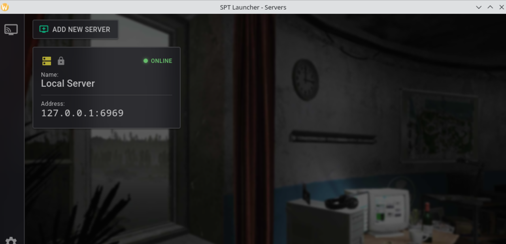

<div align="center">

# AnkerGames unter Linux

**Zwei Fixes für Spiele, die nicht starten. Keiner fasst die Spieldateien an.**

[English](README.md) · [Tarkov-Anleitung](docs/de/tarkov.md) · [Co-op](docs/de/coop.md) · [Hintergrund](docs/de/hintergrund.md)


</div>

AnkerGames startet Spiele über `umu-run` und Proton. Dabei geht an zwei
verschiedenen Stellen etwas schief:

* **Online-Fix-Builds** erreichen Steam nicht — im Wine-Prefix fehlen ein paar
  Dateien und ein DLL-Override wird nicht gesetzt. Fixes [A und B](#online-fix-builds).
* **SPP Tarkov** braucht .NET-Runtimes im Prefix und einen Launcher, der kein
  WebView2 ist — vier Befehle, siehe [Tarkov-Anleitung](docs/de/tarkov.md).

## Was willst du tun?

| Ich möchte… | Hier weiter |
|---|---|
| SPP Tarkov spielen | [Tarkov-Anleitung](docs/de/tarkov.md) — oder die vier Befehle unten |
| Tarkov im Co-op mit einem Freund spielen | [Co-op-Anleitung](docs/de/coop.md) |
| ein anderes AnkerGames-Spiel reparieren | [Online-Fix-Builds](#online-fix-builds) |
| verstehen, warum es kaputt ist | [Hintergrund](docs/de/hintergrund.md) |

---

## SPP Tarkov: vier Befehle

Im Repo-Ordner ausführen. Die beiden Pfade stehen in AnkerGames (Spiel →
Launch-Einstellungen); typische Werte:

| Platzhalter | Beispiel |
|---|---|
| `<prefix>` | `/mnt/daten/Games/AnkerGames/Games/Prefixes/3089` |
| `<Spielordner>` | `/mnt/daten/Games/AnkerGames/Games/Escape from Tarkov-3089` |

```sh
# 1 · .NET 10 für Installer, Server und Launcher
scripts/install-dotnet-runtime.sh "<prefix>"

# 2 · ASP.NET Core für den SPT-Server
scripts/install-dotnet-runtime.sh "<prefix>" --aspnet

# 3 · Play startet das Spiel, nicht den Installer
scripts/spp-tarkov-play-target.sh "<Spielordner>" "<prefix>"

# 4 · Play startet den nativen Launcher, nicht das weiße WebView2-Fenster
scripts/spp-tarkov-linux-launcher.sh "<prefix>"
```

AnkerGames vor Schritt 3 schließen (es schreibt seine Library-Datei beim Start
neu), danach wieder öffnen und **Play** drücken.



Es sollte das Fenster **SPT Launcher** erscheinen, `Local Server` springt nach
etwa 40 Sekunden auf ONLINE, und **START GAME** startet das Spiel.

> Weißes Fenster oder kein Mauszeiger? Schritt 4 hat nicht gegriffen — siehe
> [Fehlersuche](docs/de/tarkov.md#fehlersuche).
> Schritt 4 startet den Server vor dem Launcher automatisch mit.

Die vollständige Anleitung (was jeder Schritt tut, Prüfung, manueller Weg,
Fehlersuche) steht in **[docs/de/tarkov.md](docs/de/tarkov.md)**.

---

## Co-op

Co-op braucht keine Extra-Installation: SPP Tarkov bringt **Fika** mit (Server
2.4.0, Client 2.4.2).

* **Host:** öffnet `6969/TCP` und `25565/UDP`, hostet den Raid.
* **Mitspieler:** trägt `https://<host>:6969` im SPT-Launcher ein, legt ein
  Profil an, joint den Raid.

Beide Checklisten, die Entscheidung Port-Forwarding/VPN und die Fehlersuche:
**[docs/de/coop.md](docs/de/coop.md)**.

---

## Online-Fix-Builds

Diese Builds nutzen Valves echten Steam-Client: Eine Proxy-DLL im Spiel lädt
`steamclient64.dll` aus dem Wine-Prefix und verbindet sie mit dem Steam-Client
auf dem Host. Unter Linux bricht die Kette an zwei Stellen:

| # | Was fehlt | Was du siehst |
|---|---|---|
| **A** | fünf Steam-Client-Dateien im Prefix | `Failed to load original steamclient. Error code: 126` — das Spiel schließt vor dem Menü |
| **B** | `WINEDLLOVERRIDES=winmm=n,b` | Spiel startet, aber `[AppId: 0] Client API initialized 0` — keine Freunde, keine Lobbys |

Beide Fixes stecken in einem Wrapper vor `umu-run`:

```sh
mkdir -p ~/.local/bin
cp scripts/fix-reference.sh ~/.local/bin/umu-run
chmod +x ~/.local/bin/umu-run
```

`~/.local/bin` muss in `PATH` vor `/usr/bin` stehen. Danach das Spiel wie gewohnt
starten. Im Spielordner ändert sich nichts.

> Auch den Tarkov-Fix nutzen? `scripts/spp-tarkov-linux-launcher.sh` **nach** dem
> Kopieren des Wrappers ausführen — es fügt seinen Block in dieselbe Datei ein.
> Wird der Wrapper erneut kopiert, ist der Block weg; dann das Skript einfach
> noch einmal ausführen.

Geprüft mit demselben Launcher, derselben Laufzeit und denselben Prefixes:

| ID | Spiel | Braucht | Ergebnis |
|---|---|---|---|
| 2006 | SCP 5K | A | `[AppId: 872670] Client API initialized 1` |
| 3645 | HYPERCHARGE: Unboxed | B | `[AppId: 523660] Client API initialized 1` |
| 2902 | Abyssus | B | Fix-DLLs im Prozess, Steam trackt das Spiel |
| 4013 | The Ascent | A + B | Fix-DLLs im Prozess, Steam trackt das Spiel |
| 4035 | Species: Unknown | B | Fix-DLLs im Prozess, Steam trackt das Spiel |

Steam zeigt diese Spiele als **AppID 480 (Spacewar)** — so funktionieren die
Builds auch unter Windows. Details, die Spiel-Matrix und der Referenzcode:
**[docs/de/hintergrund.md](docs/de/hintergrund.md)**.

---

## Dokumentation

| Dokument | English | Inhalt |
|---|---|---|
| [tarkov.md](docs/de/tarkov.md) | [tarkov.md](docs/en/tarkov.md) | SPP Tarkov von Play bis ins Spiel, Schritt für Schritt |
| [coop.md](docs/de/coop.md) | [coop.md](docs/en/coop.md) | Fika: Host, Mitspieler, Ports, Fehlersuche |
| [hintergrund.md](docs/de/hintergrund.md) | [background.md](docs/en/background.md) | wie Online-Fix-Builds funktionieren, Defekt A/B, Belege |

---

## Aufbau des Repos

```
README.md                             diese Seite (Englisch, Standard)
README.de.md                          dieselbe Seite auf Deutsch
docs/en/, docs/de/                    tarkov, coop, hintergrund — beide Sprachen
evidence/                             rohe Log-Auszüge 01–10
scripts/fix-reference.sh              beide Online-Fix-Fixes (der umu-Wrapper)
scripts/install-dotnet-runtime.sh     .NET-Runtimes 10 in einen Prefix
scripts/spp-tarkov-play-target.sh     Play startet das Spiel, nicht den Installer
scripts/spp-tarkov-linux-launcher.sh  Play startet den nativen SPT-Launcher
scripts/spp-tarkov-server.sh          startet den nativen SPT-Server manuell
assets/                               Screenshots und das Pipeline-Diagramm
```

---

## Geltungsbereich

* Getestet mit Anker Launcher 0.1.30/0.1.33, umu-launcher 1.4.3, Proton
  Experimental, nativem Steam, CachyOS / KDE Wayland / NVIDIA.
* Es werden keine Spieldateien verändert und kein DRM umgangen. Die Fixes
  bereiten nur den Wine-Prefix vor und setzen einen Wine-DLL-Override — genau
  das, was Protons eigenes `proton`-Skript beim Anlegen eines Prefixes tut.
* Das ist eine Beobachtung mit reproduzierbarem Fix, keine offizielle Aussage
  von AnkerGames.

<div align="center">

MIT-Lizenz · geschrieben von [benjarogit](https://github.com/benjarogit) · November 2026

</div>
