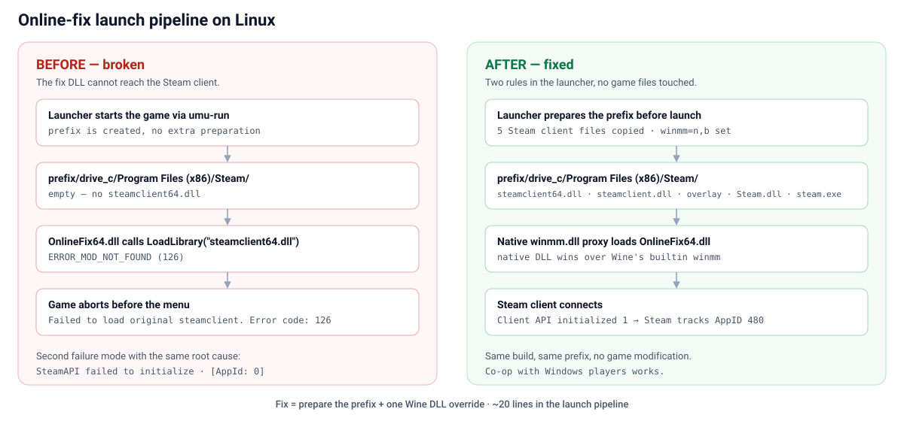

<div align="center">

# Anker Launcher on Linux

**Online-fix builds never reach Steam. Two launcher-side fixes make them work.**

[Deutsch](README.de.md) · [Root cause](docs/en/root-cause.md) · [Per game](docs/en/per-game.md) · [Evidence](docs/en/evidence.md) · [Tarkov fix](docs/en/dotnet-installer.md)


</div>



---

## The short version

AnkerGames ships "online-fix" builds that keep using Valve's real Steam client:
a proxy DLL inside the game loads `steamclient64.dll` from the Wine prefix and
connects it to the Steam client running on the host. That is why co-op with
Windows players works — the game talks to real Steam, it just presents itself
as **AppID 480 (Spacewar)**.

On Linux that chain breaks in two places, and both are in the launcher, not in
the game:

| # | What the launcher does wrong | What the player sees |
|---|---|---|
| **A** | The online-fix marker scan stops too early, so UE4/UE5 builds (marker 7–8 folders deep) never get the five Steam client files copied into their prefix | `Failed to load original steamclient. Error code: 126` — the game closes before the menu |
| **B** | `WINEDLLOVERRIDES=winmm=n,b` is never set, so Wine ignores the bundled native `winmm.dll` proxy and loads its builtin one instead | Game starts, but `SteamAPI failed to initialize` / `[AppId: 0] Client API initialized 0` — no friends, no lobbies |

Fix A copies five files. Fix B appends one environment variable. That is the
whole change — roughly 20 lines in the launch pipeline.

---

## Results

Both fixes applied manually, five games, same builds, same prefixes:

| ID | Game | Fix layout | Real AppID | Steam initialised | Steam tracks |
|----|------|-----------|-----------|-------------------|--------------|
| 2006 | SCP 5K | `steam_api64.dll` | 872670 | ✅ `[AppId: 872670] Client API initialized 1` | AppID 480 |
| 3645 | HYPERCHARGE: Unboxed | `winmm.dll` proxy | 523660 | ✅ `[AppId: 523660] Client API initialized 1` | AppID 480 |
| 2902 | Abyssus | `winmm.dll` proxy | 1721110 | ✅ fix DLLs mapped in the process | AppID 480 |
| 4013 | The Ascent | `winmm.dll` + union-crax | 979690 | ✅ fix DLLs mapped in the process | AppID 480 |
| 4035 | Species: Unknown | `winmm.dll` proxy | 2747330 | ✅ fix DLLs mapped in the process | AppID 480 |

"Steam tracks AppID 480" is expected and correct: the fix spoofs Spacewar so
Steam allows the client API without owning the game. Friends see you as
"Spacewar" — that is how these builds work on Windows too.

---

## Workaround today (no launcher update needed)

The launcher calls `umu-run`. Put a wrapper earlier in `PATH` and it will
prepare the prefix before every launch:

```sh
mkdir -p ~/.local/bin
cp scripts/fix-reference.sh ~/.local/bin/umu-run
chmod +x ~/.local/bin/umu-run
```

Make sure `~/.local/bin` comes before `/usr/bin` in `PATH`. The script exits
with `exec /usr/bin/umu-run "$@"` — adjust that path if your `umu-run` lives
somewhere else.

Then start the game from the launcher as usual. Nothing in the game folder is
modified, and the launcher keeps working normally.

> The wrapper also needs to keep doing whatever your setup already needed
> (e.g. the AppImage environment cleanup). Add those lines at the top; the two
> fix functions are independent.

---

## For the launcher maintainers

Three changes, in order of preference:

1. **Use the catalog flag.** Every affected game is already `online_fix: true`.
   Place the five files when that flag is set — no filesystem guessing needed.
   If you keep the scan, walk the whole game root (depth 8 covers every UE4/UE5
   layout we have seen) and add `union-crax.ini` to the marker list.
2. **Re-check on every launch.** Proton only copies these files while it
   creates or upgrades a prefix. After the first start, a launcher update or a
   reinstall, the folder is empty again.
3. **Set the DLL override.** When a native `winmm.dll` sits under the game
   folder, append `winmm=n,b` to `WINEDLLOVERRIDES` — append, never overwrite,
   because the variable is a semicolon-separated list and may already contain
   the launcher's own overrides.

The exact code is in [`scripts/fix-reference.sh`](scripts/fix-reference.sh)
(~60 commented lines, `sh`, no dependencies).

---

## Documentation

Four documents, English and German. They build on each other:

| Document | English | Deutsch | Covers |
|---|---|---|---|
| Root cause | [root-cause.md](docs/en/root-cause.md) | [ursachen.md](docs/de/ursachen.md) | how the builds work, defect A and B, reference code, verification |
| Per game | [per-game.md](docs/en/per-game.md) | [spiele.md](docs/de/spiele.md) | the five-game matrix, marker layouts, titles that only look affected |
| Evidence | [evidence.md](docs/en/evidence.md) | [evidenz.md](docs/de/evidenz.md) | annotated log excerpts 01–08 and the evidence sheet |
| Tarkov fix | [dotnet-installer.md](docs/en/dotnet-installer.md) | [dotnet-installer.md](docs/de/dotnet-installer.md) | .NET runtimes, native SPT server, WebView2 flags, Play target |

Read the first three in order. The Tarkov fix is independent of the online-fix
defects.

### SPP Tarkov (3089): .NET Desktop Runtime

A different failure with the same flavour — a missing prerequisite in the
prefix, not a Steam bug. `SPP_Tarkov_Installer.exe` is a framework-dependent
WPF app for .NET 10, and the prefix has no `Microsoft.WindowsDesktop.App`, so
the app host stops with *"You must install .NET Desktop Runtime to run this
application"*.

One command fixes it, without running any Windows installer:

```sh
scripts/install-dotnet-runtime.sh "<prefix>"
```

It extracts the official win-x64 runtime zips into
`<prefix>/drive_c/Program Files/dotnet`, the default probe path of the .NET app
host. Verified with Proton Experimental: the setup wizard starts and runs
without any environment variable.

The local server needs two more pieces. `SPT.Server.exe` also requires
`Microsoft.AspNetCore.App` (`--aspnet`), and under Wine it then fails to create
its TLS certificate (CNG/`CopyWithPrivateKey` is not implemented). The package
ships a native server, so the working setup is:

```sh
scripts/install-dotnet-runtime.sh "<prefix>" --aspnet
scripts/spp-tarkov-server.sh "<game dir>"      # starts SPT_Runtime/SPT.Server.Linux
```

The launcher's "Local Server" card turns ONLINE after ~40 s and stays usable.
Details, screenshots and troubleshooting:
[docs/en/dotnet-installer.md](docs/en/dotnet-installer.md).

Play still runs the installer, because that is all the package contains — and it
re-extracts 64.7 GB every time. One more script points Play at the SPT launcher:

```sh
scripts/spp-tarkov-play-target.sh "<game dir>" "<prefix>"
```

---

## Repository layout

```
README.md                          this page (English, default)
README.de.md                       the same overview in German
docs/en/                           root-cause, per-game, evidence, dotnet-installer
docs/de/                           German versions of the same four documents
evidence/                          raw log excerpts 01–08, referenced by the docs
scripts/fix-reference.sh           reference implementation of both online-fix fixes
scripts/install-dotnet-runtime.sh  provisions .NET runtimes 10 into a prefix
scripts/spp-tarkov-server.sh       starts the native SPT server (SPP Tarkov)
scripts/spp-tarkov-play-target.sh  makes Play start the game instead of the installer
assets/before-after.svg            the pipeline diagram above
assets/evidence.png                one-page evidence sheet (logs, before/after)
assets/spp-tarkov-*.png            installer dialog and setup wizard (before/after)
```

---

## Known limitation

Steam only injects its overlay into games **it** launches. A game started by
the launcher is tracked as AppID 480 but gets no `gameoverlayui` process, so
Shift+Tab does nothing and overlay invites are unavailable. The Steam API
itself works — friends list, lobbies, server browsers, direct joins from inside
the game.

If overlay invites matter, the clean solution is an opt-in **"Add to Steam"**
action: create a non-Steam shortcut and let Steam start the game. The launcher
already has the shortcut plumbing (`steam_shortcut_add`). That path needs the
same five files in Steam's own compatdata prefix.

---

## Scope

* Linux runtime only: umu-launcher + Proton. Tested with Anker Launcher 0.1.33,
  umu-launcher 1.4.3, Proton Experimental (prefix `11.0-100`), native Steam,
  CachyOS / KDE Wayland / NVIDIA.
* No game files are modified, no DRM is circumvented. The fixes only prepare
  the Wine prefix and set one Wine DLL override — the same thing Proton's own
  `proton` script does when it creates a prefix.
* The report describes observed behaviour and a reproducible fix. It is not an
  official AnkerGames statement.

---

<div align="center">

MIT licensed · written by [benjarogit](https://github.com/benjarogit) · November 2026

</div>
