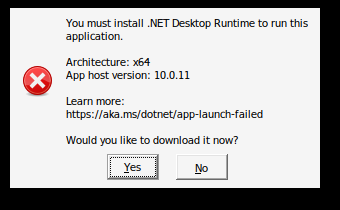
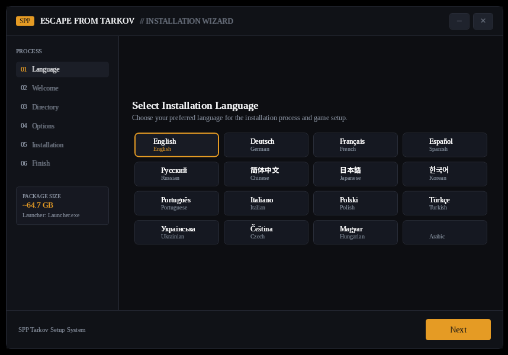
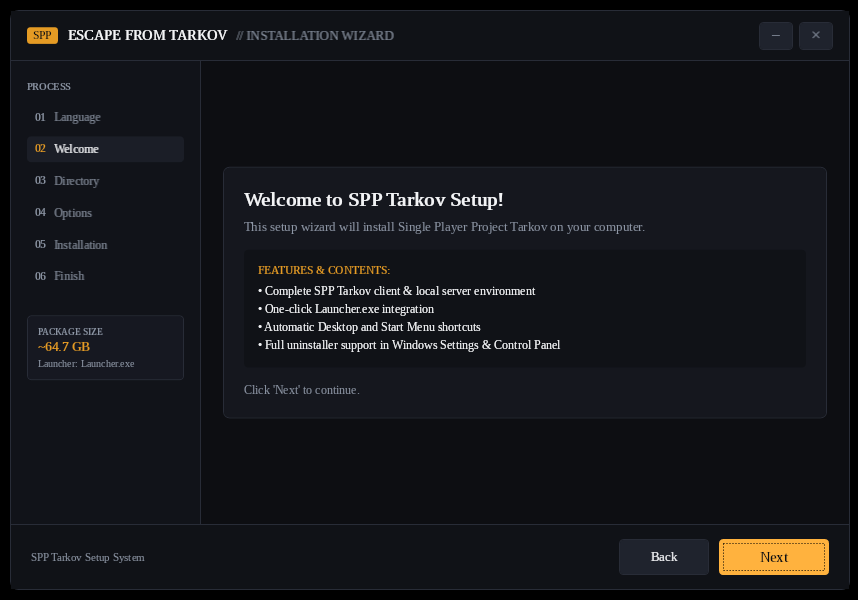

# SPP Tarkov: Der Installer braucht die .NET Desktop Runtime

[← Übersicht](../../README.de.md) · [Ursachen](ursachen.md) · [Spiele](spiele.md) · [Evidenz](evidenz.md) · [Tarkov-Fix](dotnet-installer.md) · **English:** [.NET installer](../en/dotnet-installer.md)

**Spiel:** Escape from Tarkov (3089) — SPP Tarkov, das Singleplayer-Projekt
**Launcher:** Anker Launcher 0.1.33, umu-launcher 1.4.3, Proton Experimental

Das ist ein anderes Problem als die [Online-Fix-Defekte](ursachen.md). Es hat
nichts mit Steam zu tun, sondern mit einer fehlenden Runtime im Wine-Prefix.

---

## Symptom

Beim Start öffnet sich ein kleiner Dialog, danach meldet der Launcher
„the game closed before its window opened“:

```
SPP_Tarkov_Installer.exe

You must install .NET Desktop Runtime to run this application.

Architecture: x64
App host version: 10.0.11

Learn more:
https://aka.ms/dotnet/app-launch-failed
```



Der „Ja“-Button öffnet nur einen Browser auf dem Host; der Windows-Installer
allein hilft nicht, weil die Runtime **im Wine-Prefix des Spiels** landen muss.

---

## Warum es scheitert

`SPP_Tarkov_Installer.exe` ist eine framework-abhängige WPF-Anwendung:

```
TargetFramework : net10.0-windows
References      : PresentationFramework, PresentationCore, WindowsBase
```

Sie enthält die Extraktionslogik für `Data.bin` (ein 34-GiB-7-Zip-Archiv) und
den Setup-Assistenten. Eine framework-abhängige .NET-App bringt die Runtime
nicht mit; sie fragt den Host nach `Microsoft.WindowsDesktop.App` 10.0.x. Wine
und Proton liefern nur einen `mscoree`-Stub und gar keine .NET-Runtime — der
App-Host bricht ab, bevor ein Fenster gezeichnet wird.

Der Prefix dieses Spiels entsteht über umu, und anders als bei anderen
Katalog-Einträgen ist keine Runtime-Anforderung hinterlegt: Im Launcher-Log
steht für andere Titel `a game runtime installed game=…`, für 3089 nichts. Das
ist die eigentliche Lücke im Launcher.

---

## Fix

Die offizielle .NET Desktop Runtime **10.0.x** in den Prefix des Spiels
installieren:

```sh
scripts/install-dotnet-runtime.sh "/mnt/daten/Games/AnkerGames/Games/Prefixes/3089"
```

Das Skript lädt die beiden offiziellen win-x64-Zips und entpackt sie nach

```
<prefix>/drive_c/Program Files/dotnet/
├── dotnet.exe
├── host/fxr/10.0.15/
└── shared/
    ├── Microsoft.NETCore.App/10.0.15/
    └── Microsoft.WindowsDesktop.App/10.0.15/
```

Das ist der Standardpfad, den der .NET-App-Host durchsucht — keine
Umgebungsvariable, kein Registry-Eintrag, keine Wrapper-Änderung nötig. Das
Skript ist idempotent: ein zweiter Lauf tut nichts. Eine Versionsangabe ist
optional; jedes `10.0.x` erfüllt das Patch-Roll-Forward des App-Hosts (`10.0.15`
wurde für die Verifikation verwendet).

Danach startet der Installer und der Assistent läuft normal:





Verifiziert mit Proton Experimental (wine-11.0): Der Assistent läuft ohne
`DOTNET_EnableWriteXorExecute=0`. Die Variable ist nur ein Fallback, falls der
App-Host mit `Failed to create CoreCLR` abbricht.

Das Standard-Installationsverzeichnis beibehalten — es ist der Spielordner, den
der Launcher verwaltet. Der Assistent entpackt `Data.bin` (~64,7 GB) und legt
`Launcher.exe` an, die der Launcher danach startet. `Launcher.exe` und der
SPT-Server sind ebenfalls .NET-Apps und nutzen dieselbe Runtime.

---

## Nach der Installation: „Local Server“ bleibt OFFLINE

Sobald der Assistent das Spiel entpackt hat, zeigt der Launcher die Serverkarte
als **Local Server · OFFLINE**. Die Karte ist nicht kosmetisch — ohne Server
lassen sich weder Profil anlegen noch Raid starten.

Es fehlen zwei verschiedene Dinge.

**1. ASP.NET Core Runtime.** `SPT.Server.exe` braucht zusätzlich zu den beiden
Runtimes oben `Microsoft.AspNetCore.App` 10.0.x. Ohne sie bricht der App-Host ab:

```
Framework: 'Microsoft.AspNetCore.App', version '10.0.0' (x64)
```

Das Skript mit `--aspnet` erneut aufrufen; es ist idempotent und ergänzt nur die
dritte Runtime:

```sh
scripts/install-dotnet-runtime.sh "<prefix>" --aspnet
```

**2. Wine kann das Server-Zertifikat nicht erzeugen.** Mit der Runtime startet
der Server und bricht dann beim Erzeugen seines selbstsignierten
TLS-Zertifikats ab:

```
System.Security.Cryptography.CryptographicException: Erfolg.
   at SPTarkov.Server.Core.Utils.CertificateHelper.GenerateSelfSignedCertificate()
   at System.Security.Cryptography.X509Certificates.X509Certificate2.CopyWithPrivateKey(...)
```

`CopyWithPrivateKey` läuft über CNG, das der Wine in Proton nicht implementiert.
Selbst erzeugte PEM-Dateien (`user/certs/server.crt` + `server.key`) helfen
nicht: Auch das Laden nutzt diesen CNG-Pfad.

### Lösung: den nativen Server verwenden

Das Paket bringt denselben Server als nativen Linux-Build mit:

```
SPT_Runtime/SPT.Server.Linux     liefert https://127.0.0.1:6969
```

Er braucht die .NET 10 **Linux**-Runtime (Core + ASP.NET Core), zum Beispiel:

```sh
curl -sSL https://dot.net/v1/dotnet-install.sh | sh -s -- \
  --channel 10.0 --runtime aspnetcore --install-dir ~/.local/share/spt-dotnet
```

Dann vor dem Launcher starten:

```sh
scripts/spp-tarkov-server.sh "<Spielordner>"
```

`<Spielordner>` ist der Ordner, der `SPT_Runtime` enthält. Das Skript startet den
Server in einer eigenen Session (er überlebt den Launcher), wartet auf
`/launcher/v2/ping` (etwa 40 s) und schreibt nach `~/.local/share/spt-server.log`.
Der Windows-Launcher spricht ihn unverändert an: Die Karte springt auf ONLINE und
Profile funktionieren. `--status` und `--stop` sind vorhanden.

Für den Autostart mit dem Spiel den umu-Wrapper ergänzen — nur den
`Launcher.exe`-Fall:

```sh
case "$1" in
  *Launcher.exe)
    [ "${GAMEID:-}" = 3089 ] && \
      "/pfad/zu/spp-tarkov-server.sh" "<Spielordner>" >/dev/null 2>&1 || true
    ;;
esac
```

Der Launcher versucht weiterhin, `SPT.Server.exe` selbst zu starten, und das
scheitert auch weiterhin; solange der native Server schon antwortet, ist das
folgenlos.

### Mods mit Windows-Pfaden

Manche Mods bauen Pfade mit Backslashes — unter Linux ganz normale
Dateinamen-Zeichen. Der Server bleibt dann beim Start stehen mit:

```
Critical exception, stopping server...
Could not find file '.../user/mods/BoxesAtRef/database\itemsToAdd.json'
```

Einen Link unter dem wörtlichen Namen anlegen:

```sh
cd "<SPT_Runtime>/user/mods/BoxesAtRef"
ln -s database/itemsToAdd.json 'database\itemsToAdd.json'
```

Für jede Datei wiederholen, die der Mod so liest.

### Launcher-Fenster: Cursor hängt, Flächen bleiben weiß

Die Launcher-Oberfläche ist Photino/Blazor auf WebView2. Mit dem Standard-GPU-Pfad
von WebView2 unter Wine zieht der Zeiger hinterher, behält die falsche Form und
das Fenster bleibt zeitweise weiß. Im selben umu-Wrapper den Software-Compositor
erzwingen:

```sh
case "$1" in
  *Launcher.exe)
    [ "${GAMEID:-}" = 3089 ] && export WEBVIEW2_ADDITIONAL_BROWSER_ARGUMENTS=\
"--disable-gpu --force-device-scale-factor=1 --disable-features=CalculateNativeWinOcclusion"
    ;;
esac
```

Mit den Flags zeichnet das Fenster ab der ersten Sekunde statt ~20 s weiß zu
bleiben, Hover-Zustände folgen dem Zeiger, und Klicks landen dort, wo der Zeiger
steht. Scrollen fühlt sich etwas weicher an — für einen Launcher in Ordnung. Mit
`SPP_KEEP_WEBVIEW_GPU=1` lässt sich der Standardpfad zum Vergleich erzwingen.

---

## Manuelle Alternative

Ohne Skript, gleiches Ergebnis:

1. `dotnet-runtime-10.0.15-win-x64.zip` und
   `windowsdesktop-runtime-10.0.15-win-x64.zip` von
   <https://dotnet.microsoft.com/download/dotnet/10.0> laden
   („Binaries“, Windows x64).
2. Beide nach `<prefix>/drive_c/Program Files/dotnet/` entpacken (die
   `shared/`-Bäume zusammenführen; das Basis-Zip bringt zusätzlich `dotnet.exe`
   und `host/` mit).

Die `.exe`-Installer **nicht** unter Wine ausführen — das sind WiX/Burn-Bundles,
die in den meisten Prefixes scheitern. Die Zips sind der zuverlässige Weg.

---

## Fehlersuche

| Symptom | Ursache | Lösung |
|---|---|---|
| weiterhin „You must install .NET Desktop Runtime“ | Runtime im falschen Prefix oder Version < 10.0 | `<prefix>/drive_c/Program Files/dotnet/shared/Microsoft.WindowsDesktop.App` prüfen |
| `Framework: 'Microsoft.AspNetCore.App', version '10.0.0'` | ASP.NET-Core-Runtime fehlt im Prefix | `scripts/install-dotnet-runtime.sh "<prefix>" --aspnet` |
| `CryptographicException: Erfolg.` bei `CopyWithPrivateKey` | CNG ist im Wine von Proton nicht implementiert | nativen Server verwenden (oben) |
| `System.ConsolePal.set_Title` / „Ungültiger Zugriff“ | `SPT.Server.exe` aus einem Unix-Terminal gestartet, also ohne Windows-Konsolenhandle | mit `wine start` starten oder den nativen Server verwenden |
| „Local Server“ bleibt ohne Fehlermeldung OFFLINE | Server läuft nicht oder bootet noch (~40 s) | `scripts/spp-tarkov-server.sh "<Spielordner>" --status` |
| `Could not find file '...database\itemsToAdd.json'` | Mod baut einen Pfad mit Backslash | Datei unter dem wörtlichen Namen verlinken (oben) |
| `Nicht behebbarer Systemfehler` / `MS.Internal.Invariant.FailFast` direkt nach dem Fenster | keine brauchbare Font-Familie im Prefix (WPF scheitert beim Text-Shaping) | `WINEPREFIX="<prefix>" winetricks -q corefonts` |
| `Failed to create CoreCLR` oder sofortiger Absturz | W^X / Write-Xor-Execute unter Wine | mit `DOTNET_EnableWriteXorExecute=0` starten |
| Installer läuft, Launcher bietet aber weiter den Installer an | Spiel in ein anderes Verzeichnis installiert | in den Spielordner des Launchers installieren |

---

## Vorschlag für den Launcher

Der Launcher installiert für andere Titel bereits Runtimes. Zwei Möglichkeiten:

* **Deklarieren.** Die .NET-Desktop-Runtime-10-Anforderung im Katalog-Eintrag
  für 3089 hinterlegen und denselben Provisioning-Schritt nutzen, den der
  Launcher für `a game runtime installed …` verwendet — am besten durch
  Entpacken der offiziellen Zips in den Prefix, das funktioniert ohne einen
  Windows-Installer.
* **Self-contained ausliefern.** Einen self-contained Build des Installers
  anfragen (`--self-contained` / Single-File). Er wird ~70 MB größer, macht die
  Abhängigkeit aber überflüssig und funktioniert in jedem Prefix.

Ein Prefix wird bei Neuinstallation oder bei Wahl eines neuen Prefixes neu
erstellt; dann muss die Runtime erneut provisioniert werden. Provisioning beim
Start (wie die Steam-Client-Dateien beim Online-Fix) ist die robuste Variante.
