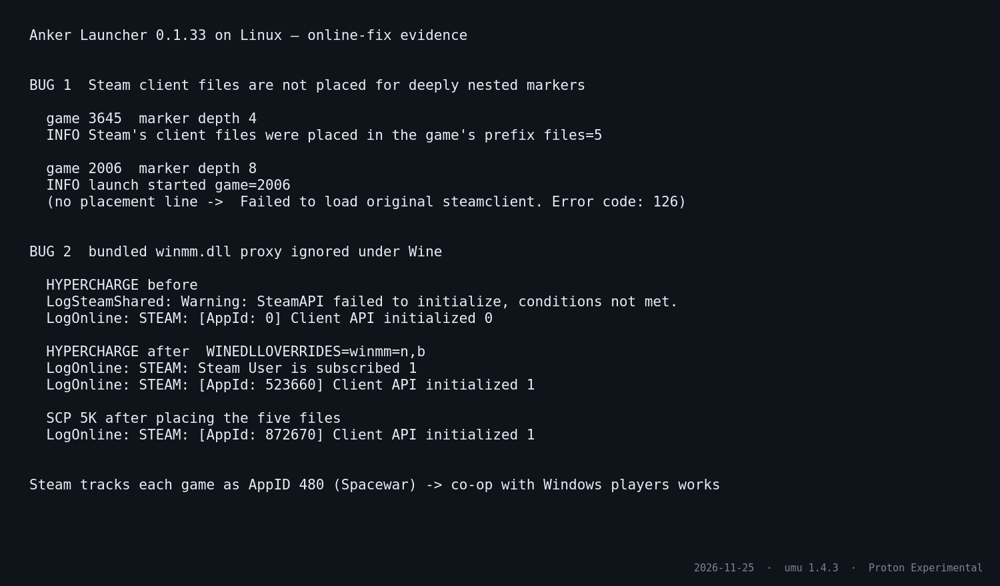

# Evidenz

[← Übersicht](../../README.de.md) · [Ursachen](ursachen.md) · [Spiele](spiele.md) · **English:** [Evidence](../en/evidence.md)

Alles hier wurde am 2026-11-25 mit Anker Launcher 0.1.33, umu-launcher 1.4.3
und Proton Experimental (`11.0-100`) aufgezeichnet. Die Pfade sind echt,
Benutzernamen sind entfernt.



---

## Index

| Datei | Quelle | Zeigt |
|-------|--------|-------|
| [`01-launcher-3645-placed.txt`](../../evidence/01-launcher-3645-placed.txt) | Anker-Launcher-Log | HYPERCHARGE (Tiefe 4) → `Steam's client files were placed … files=5` |
| [`02-launcher-2006-missing.txt`](../../evidence/02-launcher-2006-missing.txt) | Anker-Launcher-Log | SCP 5K (Tiefe 8) → keine Kopierzeile, dann Fehler 126 |
| [`03-hypercharge-before.txt`](../../evidence/03-hypercharge-before.txt) | `Unboxed.log` | `SteamAPI failed to initialize` · `[AppId: 0]` |
| [`04-hypercharge-after.txt`](../../evidence/04-hypercharge-after.txt) | `Unboxed.log` | `Steam SDK Loaded!` · `[AppId: 523660] Client API initialized 1` |
| [`05-scp5k-steam-init.txt`](../../evidence/05-scp5k-steam-init.txt) | `Pandemic.log` | `[AppId: 872670] Client API initialized 1` nach dem Kopieren |
| [`06-steam-tracks-480.txt`](../../evidence/06-steam-tracks-480.txt) | `gameprocess_log.txt` | Steam trackt die extern gestarteten Spiele als AppID 480 |
| [`07-prefix-layout.txt`](../../evidence/07-prefix-layout.txt) | `ls -l` | die fünf erwarteten Dateien im Prefix |

---

## 01 · Launcher kopiert, wenn der Marker flach liegt

```
2026-11-25T16:24:58Z  INFO launch started game=3645
2026-11-25T16:24:59Z  INFO Steam's client files were placed in the game's prefix files=5
2026-11-25T16:24:59Z  INFO loader and Python variables the game's command gets set="none"
2026-11-25T16:25:00Z  INFO game started game=3645 program="Unboxed.exe"
```

## 02 · Gleicher Launcher, tieferer Marker, keine Kopie

```
2026-11-25T16:28:53Z  INFO launch started game=2006
2026-11-25T16:29:45Z  INFO loader and Python variables the game's command gets set="none"
                       (keine Zeile "Steam's client files were placed")
```

Der 2006-Prefix enthielt nur `appcache/`, `config/` und `steamapps/`. Danach
meldete die Fix-DLL:

```
Failed to load original steamclient. Error code: 126
```

## 03 · HYPERCHARGE vor dem DLL-Override

```
LogSteamShared: Warning: SteamAPI failed to initialize, conditions not met.
LogOnline: Warning: STEAM: Steamworks: SteamUser() failed!
LogOnline: Warning: STEAM: Steamworks: SteamFriends() failed!
LogOnline: STEAM: [AppId: 0] Client API initialized 0
LogOnline: Warning: STEAM: Steam API failed to initialize!
```

Die fünf Steam-Dateien lagen bereits im Prefix — es fehlte nur der
`winmm`-Override.

## 04 · HYPERCHARGE nach `WINEDLLOVERRIDES=winmm=n,b`

```
LogSteamShared: Steam SDK Loaded!
LogOnline: STEAM: Steam User is subscribed 1
LogOnline: STEAM: [AppId: 523660] Client API initialized 1
```

## 05 · SCP 5K nach dem Kopieren der Dateien

```
LogSteamShared: Display: Loading Steam SDK 1.51
LogSteamShared: Steam SDK Loaded!
LogOnline: STEAM: Steam User is subscribed 1
LogOnline: STEAM: [AppId: 872670] Client API initialized 1
LogOnline: STEAM: AUTH: Steam Auth Enabled
```

## 06 · Steam trackt die Spiele als AppID 480

```
[2026-11-25 17:46:45] AppID 480 PID 222824 was launched outside Steam, using container PID 222681 as root
[2026-11-25 17:59:30] AppID 480 adding PID 230454 as a tracked process
[2026-11-25 18:01:17] AppID 480 adding PID 231790 as a tracked process
[2026-11-25 18:11:01] AppID 480 adding PID 236022 as a tracked process
```

`AppID 480 adding PID … as a tracked process` erscheint nur nach einem
erfolgreichen Handshake mit dem Steam-Client. Das ist der Nachweis für Builds
ohne UE-Log.

## 07 · Erwartetes Prefix-Layout

```
-rwxr-xr-x  1692312  GameOverlayRenderer64.dll
-rwxr-xr-x 26787480  steamclient64.dll
-rwxr-xr-x 21837464  steamclient.dll
-rwxr-xr-x   385312  Steam.dll
-rwxr-xr-x  2812312  steam.exe
```

`steam.exe` ist die umbenannte `legacycompat/SteamService.exe` — genau das, was
Protons eigener Prefix-Setup ebenfalls tut.
