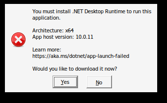
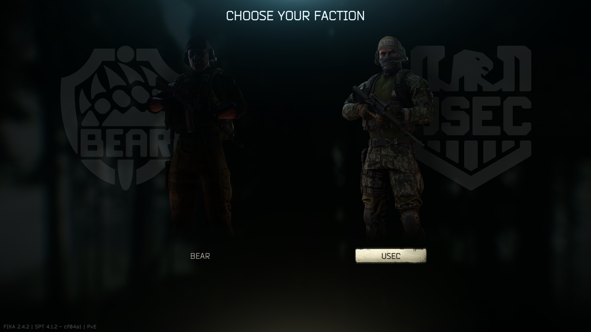

# SPP Tarkov unter Linux: von Play bis ins Spiel

[← Übersicht](../../README.de.md) · [Co-op](coop.md) · [Hintergrund](hintergrund.md) · **English:** [Tarkov](../en/tarkov.md)

**Spiel:** Escape from Tarkov (3089) — das SPP-Tarkov-Singleplayer-Paket
**Getestet mit:** Anker Launcher 0.1.30/0.1.33, umu-launcher 1.4.3, Proton
Experimental (`11.0-100`), CachyOS / KDE Wayland

Das hat nichts mit Steam zu tun. Das Paket braucht .NET-Runtimes in seinem
Wine-Prefix, und sein Windows-Launcher rendert unter Wine nicht. Vier Schritte
beheben beides — im [README](../../README.de.md) stehen sie als Copy-Paste-Block,
hier werden sie erklärt.

---

## Was kaputt ist

| # | Problem | Was du siehst |
|---|---|---|
| 1 | Der Installer ist eine .NET-10-WPF-App, im Prefix fehlt die Runtime | *„You must install .NET Desktop Runtime"* |
| 2 | Der SPT-Server braucht ASP.NET Core | `Framework: 'Microsoft.AspNetCore.App', version '10.0.0'` |
| 3 | Play startet den **Installer**, nicht das Spiel | der Wizard entpackt bei jedem Play erneut 64,7 GB |
| 4 | Der Windows-Launcher ist WebView2 unter Wine | weißes Fenster, Mauszeiger verschwindet |

Schritte 1–2 beheben die Runtime, Schritt 3 das Play-Ziel, Schritt 4 das
Launcher-Fenster.

---

## Bevor du anfängst

* AnkerGames mit installiertem SPP Tarkov (3089).
* Dieses Repository und eine Shell in seinem Ordner.
* Zwei Pfade — zu finden in AnkerGames → Spiel → Launch-Einstellungen:

| Platzhalter | Beispiel |
|---|---|
| `<prefix>` | `/mnt/daten/Games/AnkerGames/Games/Prefixes/3089` |
| `<Spielordner>` | `/mnt/daten/Games/AnkerGames/Games/Escape from Tarkov-3089` |

---

## Schritt 1 · .NET 10 in den Prefix

`SPP_Tarkov_Installer.exe` ist framework-dependent (`net10.0-windows`) und
verlangt `Microsoft.WindowsDesktop.App` 10.0.x. Wine bringt gar kein .NET mit,
also stoppt der App-Host, bevor ein Fenster erscheint:



```sh
scripts/install-dotnet-runtime.sh "<prefix>"
```

Das Skript lädt die offiziellen win-x64-Runtime-Zips und entpackt sie nach
`<prefix>/drive_c/Program Files/dotnet` — der Standard-Suchpfad des .NET
App-Hosts, daher sind weder Umgebungsvariable noch Registry-Änderung nötig. Es
ist idempotent.

Die `.exe`-Installer **nicht** unter Wine ausführen: Das Bundle ist eine
WiX/Burn-Executable und scheitert in den meisten Prefixes. Die Zips sind der
zuverlässige Weg.

---

## Schritt 2 · ASP.NET Core für den Server

`SPT.Server.exe` braucht zusätzlich `Microsoft.AspNetCore.App`:

```sh
scripts/install-dotnet-runtime.sh "<prefix>" --aspnet
```

Fügt nur die dritte Runtime hinzu; kann gefahrlos erneut laufen.

---

## Schritt 3 · Play muss das Spiel starten, nicht den Installer

`Play` startet `SPP_Tarkov_Installer.exe`, weil das Paket nichts anderes enthält
— das Archiv besteht aus Installer und `Data.bin`, und nichts sagt dem Launcher,
was danach starten soll.

> **Frische Installation?** Jetzt einmal Play drücken, den Wizard durchlaufen
> (er entpackt ~64,7 GB in den Spielordner), dann hier weitermachen.

```sh
scripts/spp-tarkov-play-target.sh "<Spielordner>" "<prefix>"
```

Das Skript kopiert den 246-KB-Stub `Launcher.exe` in den Spielordner, verlinkt
`SPT_Runtime` und trägt `Launcher.exe` als Executable des Spiels in
`~/.config/net.ankergames.launcher/library.json` ein (Backup inklusive).

**AnkerGames vorher schließen** — es schreibt die Datei beim Start neu.

Manuelle Alternative: AnkerGames → Spiel → Launch-Einstellungen →
`Launcher.exe` wählen.

---

## Schritt 4 · Der native Launcher statt WebView2

Der Windows-Launcher ist Photino/Blazor auf WebView2. Unter Wine ist seine Seite
eine D3D-Swapchain in einem Kindfenster von `msedgewebview2.exe`, und diese
Fläche wird nicht dargestellt — das Fenster bleibt weiß. WebView2 setzt außerdem
den Cursor aus dem Browser-Prozess, und Wine kann dieses Handle nicht in einen
X11-Cursor übersetzen ([Wine-Bug 58922](https://bugs.winehq.org/show_bug.cgi?id=58922)).

`WEBVIEW2_ADDITIONAL_BROWSER_ARGUMENTS=--disable-gpu` ist der übliche Tipp und
kann hier nicht wirken: Photino übergibt eigene `AdditionalBrowserArguments`,
deshalb ignoriert WebView2 sowohl die Umgebungsvariable als auch die
Registry-Policy.

Das Paket liefert denselben Launcher nativ für Linux mit. Er rendert mit
GTK/WebKit — kein Wine, kein WebView2 — und startet das Spiel selbst über
umu/Proton:

```sh
scripts/spp-tarkov-linux-launcher.sh "<prefix>"
```

Das Skript macht zwei Dinge:

1. Es schreibt `SPT_Runtime/user/Launcher/LauncherSettings.json` (Backup
   inklusive):

   | Schlüssel | Wert |
   |---|---|
   | `GamePath` | `<prefix>/drive_c/Games/SPP-Tarkov` |
   | `LinuxSettings.PrefixPath` | `<prefix>` |
   | `LinuxSettings.UmuPath` | `/usr/bin/umu-run` — das Python-Skript, kein Shell-Wrapper |
   | `LinuxSettings.ProtonVersion` | der Proton-Ordner, z. B. `…/common/Proton - Experimental` |

2. Es fügt einen markierten Block in `~/.local/bin/umu-run` ein. Für eine
   `Launcher.exe`, neben der `SPT_Runtime/SPT.Launcher.Linux` liegt, startet der
   Block den nativen Launcher — und vorher den nativen Server, falls er noch
   nicht antwortet.

Der Block erkennt die Datei, nicht die `GAMEID`: AnkerGames nutzt je nach
Installation `3089` oder `umu-<Nummer>`.

---

## Schritt 5 · Prüfen, ob es läuft

**Play** drücken. Erwartet:

1. Ein Fenster mit dem Titel **SPT Launcher** (der native; der Windows-Launcher
   heißt *SPP Tarkov - Servers*).
2. `Local Server` springt nach ~40 s auf **ONLINE**.
3. **START GAME** → `EscapeFromTarkov.exe` unter Proton → Charakterbildschirm.




Das Launcher-Fenster ist der native Build, der Mauszeiger ist also der normale
Desktop-Cursor.

---

## Alltag

* Einfach **Play** drücken. Der Wrapper startet den nativen Server, dann den
  Launcher.
* Server manuell:

  ```sh
  scripts/spp-tarkov-server.sh "<Spielordner>"            # starten
  scripts/spp-tarkov-server.sh "<Spielordner>" --status   # läuft er?
  scripts/spp-tarkov-server.sh "<Spielordner>" --stop     # stoppen
  ```

* `SPP_WINE_LAUNCHER=1` startet stattdessen den **Windows**-Launcher unter Wine.
  Er braucht Windows-Pfade in `LauncherSettings.json`, und das Problem mit
  weißem Fenster und Cursor bleibt — nur zum Vergleich sinnvoll.
* Ein neuer oder neu angelegter Prefix braucht die Schritte 1, 2 und 4 erneut.

---

## Fehlersuche

| Symptom | Ursache | Fix |
|---|---|---|
| Fenster bleibt weiß, Titel *SPP Tarkov - Servers* | der Windows-Launcher läuft | Schritt 4 erneut ausführen; sicherstellen, dass `SPP_WINE_LAUNCHER` nicht gesetzt ist |
| Fenster weiß **und** kein Cursor | Windows-Launcher + [Wine-Bug 58922](https://bugs.winehq.org/show_bug.cgi?id=58922) | dasselbe — den nativen Launcher nutzen |
| Weiterhin *„You must install .NET Desktop Runtime"* | Runtime im falschen Prefix, oder Version < 10.0 | `<prefix>/drive_c/Program Files/dotnet/shared/Microsoft.WindowsDesktop.App` prüfen |
| `Framework: 'Microsoft.AspNetCore.App', version '10.0.0'` | ASP.NET-Core-Runtime fehlt | `scripts/install-dotnet-runtime.sh "<prefix>" --aspnet` |
| `CryptographicException: Erfolg.` bei `CopyWithPrivateKey` | CNG ist in Progons Wine nicht implementiert | nativen Server nutzen (Schritt 4 / `spp-tarkov-server.sh`) |
| `System.ConsolePal.set_Title` / „Ungültiger Zugriff" | `SPT.Server.exe` aus einem Unix-Terminal gestartet, kein Windows-Consolenhandle | mit `wine start` starten, oder den nativen Server nutzen |
| `Local Server` bleibt OFFLINE ohne Fehler | Server läuft nicht oder bootet noch (~40 s) | `scripts/spp-tarkov-server.sh "<Spielordner>" --status` |
| `Could not find file '...database\itemsToAdd.json'` | ein Mod baut einen Pfad mit Backslash | Datei unter dem literalen Namen verlinken: `ln -s database/itemsToAdd.json 'database\itemsToAdd.json'` |
| `Nicht behebbarer Systemfehler` / `MS.Internal.Invariant.FailFast` direkt nach dem Fenster | keine nutzbare Schriftfamilie im Prefix | `WINEPREFIX="<prefix>" winetricks -q corefonts` |
| `Failed to create CoreCLR` oder sofortiger Absturz | W^X unter Wine | mit `DOTNET_EnableWriteXorExecute=0` starten |
| Installer startet, aber Play bietet weiter den Installer an | Spiel außerhalb des verwalteten Ordners installiert, oder Schritt 3 nicht angewandt | in den verwalteten Ordner installieren; Schritt 3 erneut ausführen |
| Launcher öffnet, **START GAME** tut nichts | Server offline oder Spielpfad falsch | Serverstatus prüfen; `GamePath` in `LauncherSettings.json` prüfen |

Logs:

```
~/.local/share/net.ankergames.launcher/logs/games/prefix-3089.log   Wrapper-Ausgabe
~/.local/share/spt-server.log                                      nativer Server
<Spielordner>/Logs/                                                Spiel-Client
```

---

## Warum es scheitert

`SPP_Tarkov_Installer.exe` ist eine framework-dependent WPF-App; eine
framework-dependent .NET-App trägt die Runtime nicht mit sich und fragt den Host
nach `Microsoft.WindowsDesktop.App`. Wine und Proton bringen ihren eigenen
`mscoree`-Stub und keine .NET-Runtime mit, also stoppt der App-Host, bevor ein
Fenster gezeichnet wird.

Beim Server kommen zwei Probleme dazu: Er braucht `Microsoft.AspNetCore.App`,
und unter Wine kann er sein selbstsigniertes TLS-Zertifikat nicht erzeugen —
`CopyWithPrivateKey` geht über CNG, das Progons Wine nicht implementiert. Auch
handgebaute PEM-Dateien helfen nicht, weil das Laden denselben Pfad nutzt. Der
native `SPT.Server.Linux` aus dem Paket umgeht beides.

Das weiße Launcher-Fenster ist das WebView2-Compositing-Problem aus Schritt 4.
Belege: [`09-spp-tarkov-linux-launcher.txt`](../../evidence/09-spp-tarkov-linux-launcher.txt)
und [`08-spp-tarkov-server.txt`](../../evidence/08-spp-tarkov-server.txt).

---

## Vorschlag für den Launcher

* **Runtime deklarieren.** .NET Desktop Runtime 10 (plus ASP.NET Core für SPT)
  beim Katalogeintrag 3089 eintragen und genauso bereitstellen wie für andere
  Titel — die offiziellen Zips zu entpacken funktioniert ohne Windows-Installer.
* **Oder self-contained ausliefern.** Ein self-contained Installer wächst um
  ~70 MB und beseitigt die Abhängigkeit komplett.
* **Nach der Installation das richtige Ziel wählen.** Nach dem Wizard liegt
  `Launcher.exe` im Spielordner; Play sollte sie starten statt des Installers.

Ein Prefix wird bei Neuinstallation oder bei Wahl eines neuen Prefixes neu
angelegt, dann muss die Runtime erneut bereitgestellt werden. Bereitstellung beim
Start ist die robuste Variante.
