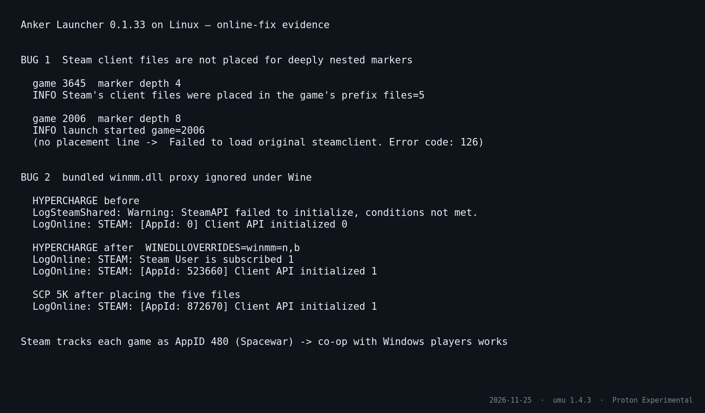

# So funktionieren die AnkerGames-Fixes

[← Spieleliste](../../README.de.md) · [Tarkov-Anleitung](games/tarkov.md) · **English:** [How it works](../en/how-it-works.md)

**Gemeldet gegen:** Anker Launcher 0.1.30/0.1.33, umu-launcher 1.4.3, Proton
Experimental (`11.0-100`), nativer Steam, CachyOS / KDE Wayland / NVIDIA.

## Anker Launcher 0.1.34

AnkerGames hat die Ursache beider Linux-Probleme bestätigt. Die frühere
allgemeine Suche endete nach drei Verzeichnisebenen. Seit 0.1.34 durchsucht der
Launcher zusätzlich `Engine/Binaries/ThirdParty/Steamworks` gezielt. So kann er
die tieferen Marker erkennen und die Steam-Client-Dateien im Prefix ablegen.
Für erkannte Online-Fix-Builds hängt der Launcher `winmm=n,b` an bestehende
`WINEDLLOVERRIDES` an. Builds ohne Online-Fix folgen laut AnkerGames dem
bisherigen Startweg. [Offizieller Launcher-Download](https://ankergames.net/launcher).

Die folgenden Abschnitte dokumentieren die ursprünglichen Fehler, den
Referenz-Wrapper und die Messungen aus 0.1.30/0.1.33.

## 1 · So funktionieren diese Builds

Online-Fix-Builds ersetzen Steam **nicht**. Die Fix-DLL (`OnlineFix64.dll` oder
ein `winmm.dll`-/`steam_api64.dll`-Proxy) lädt **Valves echte
`steamclient64.dll`** aus dem Wine-Prefix und verbindet sie mit dem Steam-Client
auf dem Host:

```
<prefix>/drive_c/Program Files (x86)/Steam/
├── steamclient.dll            (aus <Steam>/legacycompat/)
├── steamclient64.dll          (aus <Steam>/legacycompat/)
├── GameOverlayRenderer64.dll  (aus <Steam>/)
├── Steam.dll                  (aus <Steam>/legacycompat/)
└── steam.exe                  (aus <Steam>/legacycompat/SteamService.exe)
```

Der Pfad kommt aus der Registry des Prefixes:

```
[Software\\Valve\\Steam\\ActiveProcess]
"SteamClientDll64"="C:\\Program Files (x86)\\Steam\\steamclient64.dll"
"SteamPath"="C:\\Program Files (x86)\\Steam"
```

Fehlende Dateien → `LoadLibrary` scheitert mit **Fehler 126**
(`ERROR_MOD_NOT_FOUND`) — genau der Fehler, den Nutzer sehen.

Proton kopiert diese Dateien selbst beim Anlegen eines Prefixes, aber **nur beim
Anlegen oder Upgrade**. Anker legt Prefixes über umu an, deshalb ist der
Kopierschritt des Launchers danach der einzige zuverlässige Weg.

---

## 2 · Defekt A — die Steam-Client-Dateien werden nicht platziert

### Symptom

```
Failed to load original steamclient. Error code: 126
```

Das Spiel schließt vor dem Hauptmenü.

### Ursache

Vor 0.1.34 erkannte der Launcher Online-Fix-Builds anhand einer Suche nach
Marker-Dateien im Spielordner. Die aus dem Launcher-Binary extrahierte Liste:

```
steam_appid.txt  steam_settings  steam_emu.ini  ColdClientLoader.ini
cream_api.ini    OnlineFix.ini   realappid      SmartSteamEmu.ini
SteamConfig.ini  CPY.ini
```

`union-crax.ini` fehlte in der ausgelesenen Liste. Die tieferen Marker
unter Steamworks lagen außerhalb der früheren allgemeinen Suche.

| Spiel | Marker | Tiefe | Ergebnis |
|------|--------|-------|----------|
| HYPERCHARGE (3645) | `HYPERCHARGE Unboxed/Unboxed/Binaries/Win64/OnlineFix.ini` | 4 | ✅ Dateien platziert |
| Abyssus (2902) | `Abyssus/RGame/Binaries/Win64/OnlineFix.ini` | 4 | ✅ würde gefunden |
| Species: Unknown (4035) | `Species Unknown/SpeciesUnknown/Binaries/Win64/OnlineFix.ini` | 4 | ✅ würde gefunden |
| The Ascent (4013) | `The Ascent/Engine/Binaries/ThirdParty/Steamworks/Steamv152/Win64/steam_emu.ini` | 7 | ❌ verpasst |
| SCP 5K (2006) | `5K/WindowsNoEditor/Engine/Binaries/ThirdParty/Steamworks/Steamv151/Win64/OnlineFix.ini` | 8 | ❌ nicht gefunden |

UE4/UE5-Builds halten die Steamworks-DLLs in
`Engine/Binaries/ThirdParty/Steamworks/<version>/Win64/`, also liegt der Fix bei
jedem UE-Build 7–8 Ebenen tief. Der Katalog weiß es besser: Alle diese Spiele
sind als `online_fix: true` markiert.

### Ursprüngliche Vorschläge für den Launcher

* **Bevorzugt:** das Katalog-Flag nutzen — bei `online_fix: true` die fünf
  Dateien platzieren. Kein Raten im Dateisystem.
* **Minimum:** den ganzen Spielordner durchsuchen (oder mindestens Tiefe 8) und
  `union-crax.ini` in die Marker-Liste aufnehmen.
* **Immer:** bei **jedem** Start prüfen. Die Dateien gehen verloren, wenn der
  Prefix neu angelegt, das Spiel neu installiert oder ein neuer Prefix gewählt
  wird.

---

## 3 · Defekt B — der native `winmm.dll`-Proxy wird ignoriert

### Symptom

Das Spiel startet, aber Steam wird nicht initialisiert:

```
LogSteamShared: Warning: SteamAPI failed to initialize, conditions not met.
LogOnline: Warning: STEAM: Steamworks: SteamUser() failed!
LogOnline: STEAM: [AppId: 0] Client API initialized 0
```

### Ursache

Der Build liefert eine native `winmm.dll` neben der ausführenden Datei
(`Unboxed/Binaries/Win64/winmm.dll`, `RGame/Binaries/Win64/winmm.dll`,
`TheAscent/Binaries/Win64/winmm.dll`). Unter Windows gewinnt das
Anwendungsverzeichnis die DLL-Suchreihenfolge, also lädt der Proxy. Unter Wine
ist die Vorgabe für `winmm` `builtin, native`, deshalb wird der Proxy
übersprungen — die originale `steam_api64.dll` läuft, und `SteamAPI_Init`
scheitert mit AppId 0.

Im untersuchten Launcher-Binary fehlte der Override. Die Versionen
0.1.30/0.1.33 setzten ihn bei diesen Starts nicht.

### Ansatz des Referenz-Wrappers

Wenn irgendwo unter dem Spielordner eine native `winmm.dll` liegt (Tiefe ≤ 4
reicht praktisch), den Override anhängen:

```sh
export WINEDLLOVERRIDES="${WINEDLLOVERRIDES:+$WINEDLLOVERRIDES;}winmm=n,b"
```

Anhängen, nie überschreiben — die Variable ist eine semikolongetrennte Liste und
enthält eventuell schon die Overrides des Launchers.

---

## 4 · Die fünf Spiele

Gleicher Launcher-Build, gleiche Laufzeit, gleiche Prefixes; der einzige
Unterschied zwischen den Läufen sind die beiden Fixes.

| ID | Spiel | Layout | Echte AppID | Fake | Marker | Tiefe | Braucht |
|----|------|--------|-----------|------|--------|-------|---------|
| 2006 | SCP 5K | A — `steam_api64.dll` | 872670 | 480 | `OnlineFix.ini` | 8 | A |
| 3645 | HYPERCHARGE: Unboxed | B — `winmm.dll` | 523660 | 480 | `OnlineFix.ini` | 4 | B |
| 2902 | Abyssus | B — `winmm.dll` | 1721110 | 480 | `OnlineFix.ini` | 4 | B |
| 4013 | The Ascent | C — `winmm.dll` + union-crax | 979690 | 480 | `steam_emu.ini` | 7 | A + B |
| 4035 | Species: Unknown | B — `winmm.dll` | 2747330 | 480 | `OnlineFix.ini` | 4 | B |

**Layout A** ersetzt `steam_api64.dll` und behält das Original als
`steam_api64.of`; die Ersetzung löst den echten Steam-Client über die Registry
auf, also wird nur Fix A gebraucht. SCP 5K ist der einzige Titel in diesem Satz.

**Layout B** legt eine native `winmm.dll` neben die Executable. Sie zieht
`OnlineFix64.dll` nach, die `SteamAPI_Init` hookt und sich mit dem echten
Steam-Client verbindet — Fix B ist nötig.

**Layout C** ist B plus `union-crax.ini` und `steam_emu.ini`. union-crax lädt
ebenfalls `steamclient64.dll`, der Marker liegt also auf Tiefe 7 und beide Fixes
sind nötig.

### Wie „Steam initialisiert" geprüft wurde

* **UE4/UE5-Spiele mit Log** (SCP 5K, HYPERCHARGE): `LogSteamShared`- /
  `LogOnline`-Zeilen. `Client API initialized 1` mit der echten AppID ist der
  eindeutige Beweis.
* **Builds ohne nutzbares UE-Log** (Abyssus, The Ascent, Species: Unknown): die
  geladenen Module (`OnlineFix64.dll`, `winmm.dll`, `steamclient64.dll`,
  `GameOverlayRenderer64.dll`) plus Steam' `gameprocess_log.txt`.
* **Alle fünf**: `~/.local/share/Steam/logs/gameprocess_log.txt` verzeichnet
  `AppID 480 adding PID … as a tracked process`, was nur nach einem
  erfolgreichen Steam-Client-Handshake passiert.

AppID 480 ist Spacewar, Valves öffentliche Test-App. Der Fix spoofed sie, damit
Steam die Client-API erlaubt, ohne das Spiel zu besitzen — identisch zum
Verhalten wurde als Steam-Prozesserkennung protokolliert. Einen
plattformübergreifenden Co-op-Beitritt belegt dieses Log nicht.

### Historische Reproduktion auf 0.1.30/0.1.33

1. Einen frischen Test-Prefix für SCP 5K (2006) verwenden.
2. Aus dem Launcher starten → `Failed to load original steamclient. Error code: 126`.
3. Die fünf Dateien in den Prefix kopieren → das Spiel startet und Steam initialisiert.
4. Spiel 3645 starten (Dateien vorhanden) → `[AppId: 0] Client API initialized 0`.
5. 3645 mit `WINEDLLOVERRIDES=winmm=n,b` starten → `[AppId: 523660] Client API initialized 1`.

---

## 5 · Referenz-Implementierung

Beide Fixes in einem Wrapper vor `umu-run` — der Code, mit dem oben verifiziert
wurde. Voll kommentiert:
[`scripts/fix-reference.sh`](../../scripts/fix-reference.sh).

```sh
# 1) Steam-Client-Dateien für jeden Online-Fix-Build (jede Marker-Tiefe)
place_steam_client() {
  [ -n "$WINEPREFIX" ] || return 0
  steam_dir="$WINEPREFIX/drive_c/Program Files (x86)/Steam"
  [ -f "$steam_dir/steamclient64.dll" ] && return 0

  find "$(dirname "$1")" -maxdepth 8 \
       \( -iname 'OnlineFix.ini' -o -iname 'union-crax.ini' -o -iname 'steam_emu.ini' \) \
       -print -quit 2>/dev/null | grep -q . || return 0

  src="$HOME/.local/share/Steam"
  [ -f "$src/steamclient64.dll" ] || return 0

  mkdir -p "$steam_dir"
  cp -L "$src/steamclient64.dll"             "$steam_dir/steamclient64.dll"
  cp -L "$src/steamclient.dll"               "$steam_dir/steamclient.dll"
  cp -L "$src/GameOverlayRenderer64.dll"     "$steam_dir/GameOverlayRenderer64.dll"
  cp -L "$src/legacycompat/Steam.dll"        "$steam_dir/Steam.dll"
  cp -L "$src/legacycompat/SteamService.exe" "$steam_dir/steam.exe"
}

# 2) Eine mitgelieferte native winmm.dll bevorzugen (OnlineFix / union-crax / RUNE)
case "$1" in
  *.exe)
    if find "$(dirname "$1")" -maxdepth 4 -iname 'winmm.dll' -print -quit 2>/dev/null | grep -q .; then
      export WINEDLLOVERRIDES="${WINEDLLOVERRIDES:+$WINEDLLOVERRIDES;}winmm=n,b"
    fi
    ;;
esac
```

Hinweise:

* **Nach** dem Anlegen des Prefixes kopieren, oder den Verzeichnisbaum selbst
  erstellen — Wine und Proton behalten vorhandene Dateien.
* `steam.exe` ist umbenannte `SteamService.exe`; genau das macht Proton.
* `cp -L` nutzen: Die Steam-Dateien können in manchen Installationen Symlinks
  sein (z. B. Flatpak).
* Die fünf Dateien erneuern, wenn der Steam-Client aktualisiert wird; Größe und
  mtime reichen zum Vergleichen.
* Die `find`-Aufrufe sind für einen Start billig, aber ein Katalog-Flag spart sie
  komplett.

---

## 6 · Belege

Aufgenommen am 2026-11-25 mit Anker Launcher 0.1.33, umu-launcher 1.4.3 und
Proton Experimental. Pfade sind echt; Benutzernamen fehlen.



| Datei | Quelle | Zeigt |
|------|--------|-------|
| [`01-launcher-3645-placed.txt`](../../evidence/01-launcher-3645-placed.txt) | Launcher-Log | HYPERCHARGE (Tiefe 4) → `Steam's client files were placed … files=5` |
| [`02-launcher-2006-missing.txt`](../../evidence/02-launcher-2006-missing.txt) | Launcher-Log | SCP 5K (Tiefe 8) → keine Platzierungszeile, dann Fehler 126 |
| [`03-hypercharge-before.txt`](../../evidence/03-hypercharge-before.txt) | `Unboxed.log` | `SteamAPI failed to initialize` · `[AppId: 0]` |
| [`04-hypercharge-after.txt`](../../evidence/04-hypercharge-after.txt) | `Unboxed.log` | `Steam SDK Loaded!` · `[AppId: 523660] Client API initialized 1` |
| [`05-scp5k-steam-init.txt`](../../evidence/05-scp5k-steam-init.txt) | `Pandemic.log` | `[AppId: 872670] Client API initialized 1` nach dem Platzieren |
| [`06-steam-tracks-480.txt`](../../evidence/06-steam-tracks-480.txt) | `gameprocess_log.txt` | Steam trackt die extern gestarteten Spiele als AppID 480 |
| [`07-prefix-layout.txt`](../../evidence/07-prefix-layout.txt) | `ls -l` | die fünf erwarteten Dateien im Prefix |
| [`08-spp-tarkov-server.txt`](../../evidence/08-spp-tarkov-server.txt) | App-Host-Ausgabe, Server-Log | fehlende ASP.NET-Runtime, CNG-Zertifikatsfehler, nativer Server antwortet |
| [`09-spp-tarkov-linux-launcher.txt`](../../evidence/09-spp-tarkov-linux-launcher.txt) | Wrapper- und Launcher-Log | nativer Launcher statt WebView2, Spielprozess, Backend-Anfragen |
| [`10-fika-coop.txt`](../../evidence/10-fika-coop.txt) | Server- und Client-Log | Fika geladen, `0.0.0.0:6969`, Login über die LAN-IP |

Zentrale Auszüge:

```
16:24:59  INFO Steam's client files were placed in the game's prefix files=5   ← 3645
16:28:53  INFO launch started game=2006                                        ← keine Platzierung
          Failed to load original steamclient. Error code: 126

- LogSteamShared: Warning: SteamAPI failed to initialize, conditions not met.
- LogOnline: STEAM: [AppId: 0] Client API initialized 0
+ LogSteamShared: Steam SDK Loaded!
+ LogOnline: STEAM: [AppId: 523660] Client API initialized 1

[2026-11-25 18:01:17] AppID 480 adding PID 231790 as a tracked process
```

Der Prefix-Inhalt (`07`):

```
-rwxr-xr-x  1692312  GameOverlayRenderer64.dll
-rwxr-xr-x 26787480  steamclient64.dll
-rwxr-xr-x 21837464  steamclient.dll
-rwxr-xr-x   385312  Steam.dll
-rwxr-xr-x  2812312  steam.exe
```

---

## 7 · Bekannte Einschränkung — Overlay und Einladungen

Steam injiziert sein Overlay (Shift+Tab, Einladungsdialog) nur in Spiele, die es
selbst startet. Ein vom Launcher gestartetes Spiel wird als AppID 480 getrackt,
bekommt aber keinen `gameoverlayui`-Prozess, deshalb tut Shift+Tab nichts. Die
Steam-API des Spiels funktioniert (Freundesliste, Lobbys, Serverlisten) und
Freunde können über die Spiel-Oberfläche beitreten, aber Overlay-Einladungen
gehen nicht.

Wenn Overlay-Einladungen wichtig sind, ist die saubere Lösung eine opt-in
Aktion **„Zu Steam hinzufügen"**: einen Nicht-Steam-Shortcut anlegen und Steam
das Spiel starten lassen (der Launcher hat bereits `steam_shortcut_add`). Dieser
Weg braucht dieselben fünf Dateien im compatdata-Prefix von Steam.

---

## 8 · Metadaten-Hinweis — das „Co-Op"-Badge

`co_op: true` ist derzeit ein Genre-Tag. Bei reinen Offline-Builds — zum Beispiel
Call of Duty: Modern Warfare II (2522), ein Goldberg-Build mit nur dem
`sp22`-Kampagnen-Client und ohne `mp22`-Ordner — liest es sich wie „Co-op
funktioniert hier".

Vorschlag: das Badge an `online_fix` / `multiplayer` koppeln oder einen
expliziten „nur offline"-Hinweis ergänzen. Die übrigen Katalog-Metadaten stimmen
für diese Titel.

---

## 9 · SPP Tarkov ist ein anderer Fehler

Escape from Tarkov (3089) ist **kein** Steam-Titel. Das Paket ist SPP Tarkov,
ein Singleplayer-Projekt mit eigenem lokalen Server; keine Steam-Client-API
beteiligt, also greift keiner der Fixes. Seine Blocker sind .NET-Runtimes, das
Play-Ziel und der WebView2-Launcher — siehe
[Tarkov-Anleitung](games/tarkov.md). Co-op ist als Fika enthalten: [Tarkov-Co-op](games/tarkov.md#3--co-op).
