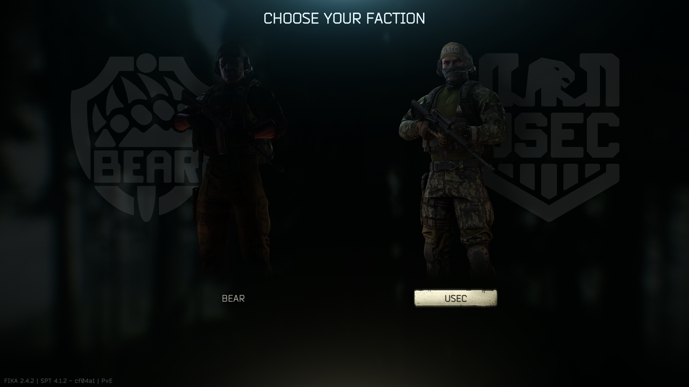

# SPP Tarkov: the installer needs .NET Desktop Runtime

[← Overview](../../README.md) · [Root cause](root-cause.md) · [Per game](per-game.md) · [Evidence](evidence.md) · [Tarkov fix](dotnet-installer.md) · **Deutsch:** [.NET-Installer](../de/dotnet-installer.md)

**Game:** Escape from Tarkov (3089) — SPP Tarkov, the single-player project
**Launcher:** Anker Launcher 0.1.33, umu-launcher 1.4.3, Proton Experimental

This is a separate issue from the [online-fix defects](root-cause.md). It has
nothing to do with Steam; it is a missing runtime in the Wine prefix.

---

## Symptom

Starting the game opens a small dialog and then the launcher reports
"the game closed before its window opened":

```
SPP_Tarkov_Installer.exe

You must install .NET Desktop Runtime to run this application.

Architecture: x64
App host version: 10.0.11

Learn more:
https://aka.ms/dotnet/app-launch-failed
```


The "Yes" button only opens a browser on the host; downloading the Windows
installer does not help by itself, because it has to land **inside the game's
Wine prefix**.

---

## Why it fails

`SPP_Tarkov_Installer.exe` is a framework-dependent WPF application:

```
TargetFramework : net10.0-windows
References      : PresentationFramework, PresentationCore, WindowsBase
```

It contains the extraction logic for `Data.bin` (a 34 GiB 7-Zip archive) and
the setup wizard. A framework-dependent .NET app does not carry the runtime; it
asks the host for `Microsoft.WindowsDesktop.App` 10.0.x. Wine and Proton ship
their own `mscoree` stub and no .NET runtime at all, so the app host stops
before any window is drawn.

The prefix of this game is created by the launcher through umu, and unlike
other catalog entries it declares no runtime requirement — the launcher log
contains `a game runtime installed game=…` for other titles, but nothing for
3089. That is the actual launcher-side gap.

---

## Fix

Install the official .NET Desktop Runtime **10.0.x** into the game's prefix:

```sh
scripts/install-dotnet-runtime.sh "/mnt/daten/Games/AnkerGames/Games/Prefixes/3089"
```

The script downloads the two official win-x64 runtime zips and extracts them to

```
<prefix>/drive_c/Program Files/dotnet/
├── dotnet.exe
├── host/fxr/10.0.15/
└── shared/
    ├── Microsoft.NETCore.App/10.0.15/
    └── Microsoft.WindowsDesktop.App/10.0.15/
```

That is the default location the .NET app host probes, so no environment
variable, registry key or wrapper change is needed. It is idempotent — running
it twice does nothing. A version argument is optional; any `10.0.x` satisfies
the app host's patch roll-forward (`10.0.15` was used for the verification).

After that the installer starts and the wizard runs normally:


Verified with Proton Experimental (wine-11.0): the wizard runs without
`DOTNET_EnableWriteXorExecute=0`. That variable is only a fallback if the app
host aborts with `Failed to create CoreCLR`.

Keep the default install directory — it is the game folder the launcher
manages. The wizard unpacks `Data.bin` (~64.7 GB) and drops `Launcher.exe` next
to the game; the launcher itself still points at the installer (see “Play keeps
opening the installer”). `Launcher.exe` and the SPT server are .NET apps as well
and use the same runtime.

---

## After the install: "Local Server" stays OFFLINE

Once the wizard has unpacked the game, the launcher shows the server card as
**Local Server · OFFLINE**. That card is not cosmetic — without the server the
launcher cannot create a profile or start a raid.

Two separate things are missing.

**1. ASP.NET Core Runtime.** `SPT.Server.exe` needs `Microsoft.AspNetCore.App`
10.0.x on top of the two runtimes above. Without it the app host stops with:

```
Framework: 'Microsoft.AspNetCore.App', version '10.0.0' (x64)
```

Re-run the script with `--aspnet`; it is idempotent and only adds the third
runtime:

```sh
scripts/install-dotnet-runtime.sh "<prefix>" --aspnet
```

**2. Wine cannot create the server certificate.** With the runtime in place the
server starts, then aborts while generating its self-signed TLS certificate:

```
System.Security.Cryptography.CryptographicException: Erfolg.
   at SPTarkov.Server.Core.Utils.CertificateHelper.GenerateSelfSignedCertificate()
   at System.Security.Cryptography.X509Certificates.X509Certificate2.CopyWithPrivateKey(...)
```

`CopyWithPrivateKey` goes through CNG, which Proton's Wine does not implement.
Hand-made PEM files (`user/certs/server.crt` + `server.key`) do not help either:
loading them uses the same CNG path.

### Fix: run the native server

The package ships the same server as a native Linux build:

```
SPT_Runtime/SPT.Server.Linux     serves https://127.0.0.1:6969
```

It needs the .NET 10 **Linux** runtime (Core + ASP.NET Core), for example:

```sh
curl -sSL https://dot.net/v1/dotnet-install.sh | sh -s -- \
  --channel 10.0 --runtime aspnetcore --install-dir ~/.local/share/spt-dotnet
```

Then start it before the launcher:

```sh
scripts/spp-tarkov-server.sh "<game dir>"
```

`<game dir>` is the folder that contains `SPT_Runtime`. The script starts the
server in its own session, so it survives the launcher, waits for
`/launcher/v2/ping` (about 40 s) and appends to `~/.local/share/spt-server.log`.
The Windows launcher talks to it unchanged: the card flips to ONLINE and
profiles work. `--status` and `--stop` are available.

To start it together with the game, hook it into the umu wrapper — the
`Launcher.exe` case only:

```sh
case "$1" in
  *Launcher.exe)
    [ "${GAMEID:-}" = 3089 ] && \
      "/path/to/spp-tarkov-server.sh" "<game dir>" >/dev/null 2>&1 || true
    ;;
esac
```

The launcher still tries to start `SPT.Server.exe` itself and that attempt keeps
failing; it is harmless as long as the native server is already answering.

### Mods with Windows paths

Some mods build paths with backslashes, which are ordinary file name characters
on Linux. The server then stops at startup with:

```
Critical exception, stopping server...
Could not find file '.../user/mods/BoxesAtRef/database\itemsToAdd.json'
```

Create a link under the literal name:

```sh
cd "<SPT_Runtime>/user/mods/BoxesAtRef"
ln -s database/itemsToAdd.json 'database\itemsToAdd.json'
```

Repeat for every file the mod reads that way.

### Play keeps opening the installer

`Play` in AnkerGames starts `SPP_Tarkov_Installer.exe`, not the game. That is how
the package is built: the archive holds the installer plus `Data.bin`, and the
file `Run SPP_Tarkov_Installer and follow the instructions.txt` is what the
launcher derives its target from. After a successful install nothing tells the
launcher what to start, so every Play re-runs the wizard and re-extracts
64.7 GB.

The launcher only accepts executables inside the game folder, so the fix mirrors
the SPT launcher into it:

```sh
scripts/spp-tarkov-play-target.sh \
  "/mnt/daten/Games/AnkerGames/Games/Escape from Tarkov-3089" \
  "/mnt/daten/Games/AnkerGames/Games/Prefixes/3089"
```

It copies the 246 KB stub `Launcher.exe` (the one the installer drops next to
the game) into the game folder, links `SPT_Runtime` to the installed one, and
records `Launcher.exe` as this game's executable in
`~/.config/net.ankergames.launcher/library.json` (backup included). Close
AnkerGames first — it rewrites that file on start.

Play then goes launcher → `Launcher.exe` → `SPT_Runtime\SPT.Launcher.exe` → the
game. The stub takes no arguments; it resolves `SPT_Runtime` relative to itself.
The next section swaps that Windows launcher for the native one.

Manual alternative: AnkerGames → the game → launch settings → choose
`Launcher.exe`.

### Launcher window: white, and the cursor disappears

The Windows launcher is Photino/Blazor on WebView2. Under Wine its page is a D3D
swapchain in a child window owned by `msedgewebview2.exe`, and that surface does
not present here — the window stays white. WebView2 also sets the cursor from the
browser process, and Wine cannot turn that handle into an X11 cursor
([Wine bug 58922](https://bugs.winehq.org/show_bug.cgi?id=58922)), so the pointer
is invisible over the window.

`WEBVIEW2_ADDITIONAL_BROWSER_ARGUMENTS=--disable-gpu` is the usual advice, but it
cannot work here: Photino passes its own `AdditionalBrowserArguments`, and
WebView2 ignores both the environment variable and the registry policy once the
app supplies arguments. Forcing `PROTON_USE_WINED3D=1` does make the Windows
launcher paint, but the game inherits it and loses DXVK.

### Fix: run the launcher that ships with the package

`SPT_Runtime/SPT.Launcher.Linux` is the same launcher built natively for Linux.
It renders with GTK/WebKit — no Wine, no WebView2 — so there is no white window
and the cursor is the normal desktop one. It starts the game through umu/Proton
itself.

Point its config at the Linux paths and hook it into the umu wrapper:

```sh
scripts/spp-tarkov-linux-launcher.sh "<prefix>"
```

The script writes `SPT_Runtime/user/Launcher/LauncherSettings.json` (backup
included):

| key | value |
| --- | --- |
| `GamePath` | `<prefix>/drive_c/Games/SPP-Tarkov` |
| `LinuxSettings.PrefixPath` | `<prefix>` |
| `LinuxSettings.UmuPath` | `/usr/bin/umu-run` — the Python script, not a shell wrapper |
| `LinuxSettings.ProtonVersion` | the Proton folder, e.g. `…/common/Proton - Experimental` |

and inserts a marked block into `~/.local/bin/umu-run`: for `GAMEID=3089` and
`Launcher.exe` it starts the native launcher, plus the native server if it is not
running yet. `Play` then goes AnkerGames → `SPT.Launcher.Linux` →
`EscapeFromTarkov.exe` under Proton. Set `SPP_WINE_LAUNCHER=1` to fall back to
the Windows launcher under Wine.


The launcher reaches character creation and the game runs:



---

## Manual alternative

If you prefer not to run the script, the same result:

1. Download `dotnet-runtime-10.0.15-win-x64.zip` and
   `windowsdesktop-runtime-10.0.15-win-x64.zip` from
   <https://dotnet.microsoft.com/download/dotnet/10.0> ("Binaries", Windows x64).
2. Extract both into `<prefix>/drive_c/Program Files/dotnet/` (merge the
   `shared/` trees; the base zip also brings `dotnet.exe` and `host/`).

Do **not** run the `.exe` installers under Wine — the bundle installer is a
WiX/Burn executable and fails in most prefixes. The zips are the reliable path.

---

## Troubleshooting

| Symptom | Cause | Fix |
|---|---|---|
| Still "You must install .NET Desktop Runtime" | runtime in the wrong prefix, or version < 10.0 | check `<prefix>/drive_c/Program Files/dotnet/shared/Microsoft.WindowsDesktop.App` |
| `Framework: 'Microsoft.AspNetCore.App', version '10.0.0'` | ASP.NET Core runtime missing in the prefix | `scripts/install-dotnet-runtime.sh "<prefix>" --aspnet` |
| `CryptographicException: Erfolg.` at `CopyWithPrivateKey` | CNG is not implemented in Proton's Wine | run the native server (above) |
| `System.ConsolePal.set_Title` / "Ungültiger Zugriff" | `SPT.Server.exe` started from a Unix terminal, so it has no Windows console handle | start it with `wine start` instead, or use the native server |
| "Local Server" stays OFFLINE without an error | server not running, or still booting (~40 s) | `scripts/spp-tarkov-server.sh "<game dir>" --status` |
| `Could not find file '...database\itemsToAdd.json'` | mod builds a path with a backslash | link the file under the literal name (above) |
| `Nicht behebbarer Systemfehler` / `MS.Internal.Invariant.FailFast` right after the window appears | no usable font family in the prefix (WPF fails while shaping text) | `WINEPREFIX="<prefix>" winetricks -q corefonts` |
| `Failed to create CoreCLR` or an immediate crash | W^X / write-xor-execute under Wine | launch with `DOTNET_EnableWriteXorExecute=0` |
| Installer starts, but the launcher keeps offering the installer | game installed to a non-default directory | reinstall into the game folder the launcher manages |

---

## Suggestion for the launcher

The launcher already provisions runtimes for other titles. Two options:

* **Declare it.** Add the .NET Desktop Runtime 10 requirement to the catalog
  entry for 3089 and run the same provisioning step the launcher uses for
  `a game runtime installed …` — ideally by extracting the official zips into
  the prefix, which works without running any Windows installer.
* **Ship it self-contained.** Ask for a self-contained build of the installer
  (`--self-contained` / single-file). It grows by ~70 MB but removes the
  dependency entirely and works on every prefix.

A prefix is recreated on reinstall or when the user picks a new prefix; the
runtime has to be provisioned again in that case. Provisioning at launch (like
the Steam client files in the online-fix fix) is the robust variant.
