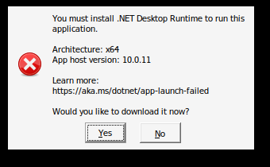
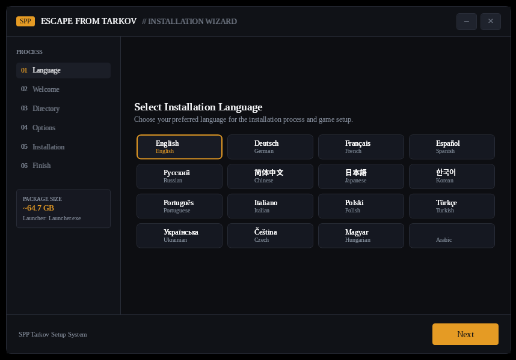
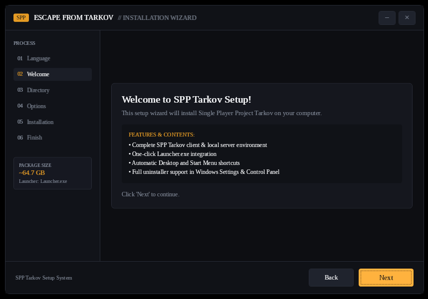

# SPP Tarkov: the installer needs .NET Desktop Runtime

[← Overview](../../README.md) · [Per game](per-game.md) · [Root cause](root-cause.md) · **Deutsch:** [.NET-Installer](../de/dotnet-installer.md)

**Game:** Escape from Tarkov (3089) — SPP Tarkov, the single-player project
**Launcher:** Anker Launcher 0.1.33, umu-launcher 1.4.3, Proton Experimental

This is a separate issue from the [online-fix defects](root-cause.md). It has
nothing to do with Steam; it is a missing runtime in the Wine prefix.

---

## Symptom

Starting the game opens a small dialog and then the launcher reports
"the game closed before its window opened":

```
SPP_Tarkov_Installer.exe

You must install .NET Desktop Runtime to run this application.

Architecture: x64
App host version: 10.0.11

Learn more:
https://aka.ms/dotnet/app-launch-failed
```



The "Yes" button only opens a browser on the host; downloading the Windows
installer does not help by itself, because it has to land **inside the game's
Wine prefix**.

---

## Why it fails

`SPP_Tarkov_Installer.exe` is a framework-dependent WPF application:

```
TargetFramework : net10.0-windows
References      : PresentationFramework, PresentationCore, WindowsBase
```

It contains the extraction logic for `Data.bin` (a 34 GiB 7-Zip archive) and
the setup wizard. A framework-dependent .NET app does not carry the runtime; it
asks the host for `Microsoft.WindowsDesktop.App` 10.0.x. Wine and Proton ship
their own `mscoree` stub and no .NET runtime at all, so the app host stops
before any window is drawn.

The prefix of this game is created by the launcher through umu, and unlike
other catalog entries it declares no runtime requirement — the launcher log
contains `a game runtime installed game=…` for other titles, but nothing for
3089. That is the actual launcher-side gap.

---

## Fix

Install the official .NET Desktop Runtime **10.0.x** into the game's prefix:

```sh
scripts/install-dotnet-runtime.sh "/mnt/daten/Games/AnkerGames/Games/Prefixes/3089"
```

The script downloads the two official win-x64 runtime zips and extracts them to

```
<prefix>/drive_c/Program Files/dotnet/
├── dotnet.exe
├── host/fxr/10.0.15/
└── shared/
    ├── Microsoft.NETCore.App/10.0.15/
    └── Microsoft.WindowsDesktop.App/10.0.15/
```

That is the default location the .NET app host probes, so no environment
variable, registry key or wrapper change is needed. It is idempotent — running
it twice does nothing. A version argument is optional; any `10.0.x` satisfies
the app host's patch roll-forward (`10.0.15` was used for the verification).

After that the installer starts and the wizard runs normally:





Keep the default install directory — it is the game folder the launcher
manages. The wizard unpacks `Data.bin` (~64.7 GB) and creates `Launcher.exe`,
which the launcher starts afterwards. `Launcher.exe` and the SPT server are
.NET apps as well and use the same runtime.

---

## Manual alternative

If you prefer not to run the script, the same result:

1. Download `dotnet-runtime-10.0.15-win-x64.zip` and
   `windowsdesktop-runtime-10.0.15-win-x64.zip` from
   <https://dotnet.microsoft.com/download/dotnet/10.0> ("Binaries", Windows x64).
2. Extract both into `<prefix>/drive_c/Program Files/dotnet/` (merge the
   `shared/` trees; the base zip also brings `dotnet.exe` and `host/`).

Do **not** run the `.exe` installers under Wine — the bundle installer is a
WiX/Burn executable and fails in most prefixes. The zips are the reliable path.

---

## Troubleshooting

| Symptom | Cause | Fix |
|---|---|---|
| Still "You must install .NET Desktop Runtime" | runtime in the wrong prefix, or version < 10.0 | check `<prefix>/drive_c/Program Files/dotnet/shared/Microsoft.WindowsDesktop.App` |
| `Nicht behebbarer Systemfehler` / `MS.Internal.Invariant.FailFast` right after the window appears | no usable font family in the prefix (WPF fails while shaping text) | `WINEPREFIX="<prefix>" winetricks -q corefonts` |
| `Failed to create CoreCLR` or an immediate crash | W^X / write-xor-execute under Wine | launch with `DOTNET_EnableWriteXorExecute=0` |
| Installer starts, but the launcher keeps offering the installer | game installed to a non-default directory | reinstall into the game folder the launcher manages |

---

## Suggestion for the launcher

The launcher already provisions runtimes for other titles. Two options:

* **Declare it.** Add the .NET Desktop Runtime 10 requirement to the catalog
  entry for 3089 and run the same provisioning step the launcher uses for
  `a game runtime installed …` — ideally by extracting the official zips into
  the prefix, which works without running any Windows installer.
* **Ship it self-contained.** Ask for a self-contained build of the installer
  (`--self-contained` / single-file). It grows by ~70 MB but removes the
  dependency entirely and works on every prefix.

A prefix is recreated on reinstall or when the user picks a new prefix; the
runtime has to be provisioned again in that case. Provisioning at launch (like
the Steam client files in the online-fix fix) is the robust variant.
