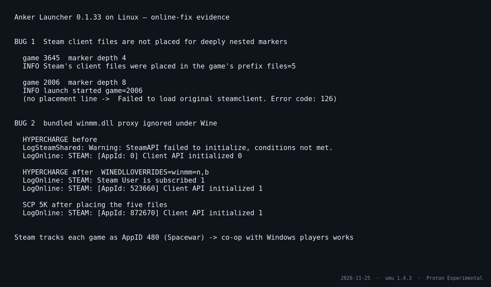

# Evidence

[← Overview](../../README.md) · [Root cause](root-cause.md) · [Per game](per-game.md) · **Deutsch:** [Evidenz](../de/evidenz.md)

Everything here was captured on 2026-11-25 with Anker Launcher 0.1.33,
umu-launcher 1.4.3 and Proton Experimental (`11.0-100`). Paths are the real
ones; user names are omitted.



---

## Index

| File | Source | Shows |
|------|--------|-------|
| [`01-launcher-3645-placed.txt`](../../evidence/01-launcher-3645-placed.txt) | Anker launcher log | HYPERCHARGE (depth 4) → `Steam's client files were placed … files=5` |
| [`02-launcher-2006-missing.txt`](../../evidence/02-launcher-2006-missing.txt) | Anker launcher log | SCP 5K (depth 8) → no placement line, then error 126 |
| [`03-hypercharge-before.txt`](../../evidence/03-hypercharge-before.txt) | `Unboxed.log` | `SteamAPI failed to initialize` · `[AppId: 0]` |
| [`04-hypercharge-after.txt`](../../evidence/04-hypercharge-after.txt) | `Unboxed.log` | `Steam SDK Loaded!` · `[AppId: 523660] Client API initialized 1` |
| [`05-scp5k-steam-init.txt`](../../evidence/05-scp5k-steam-init.txt) | `Pandemic.log` | `[AppId: 872670] Client API initialized 1` after the files were placed |
| [`06-steam-tracks-480.txt`](../../evidence/06-steam-tracks-480.txt) | `gameprocess_log.txt` | Steam tracks the externally started games as AppID 480 |
| [`07-prefix-layout.txt`](../../evidence/07-prefix-layout.txt) | `ls -l` | the five expected files in the prefix |

---

## 01 · Launcher places the files when the marker is shallow

```
2026-11-25T16:24:58Z  INFO launch started game=3645
2026-11-25T16:24:59Z  INFO Steam's client files were placed in the game's prefix files=5
2026-11-25T16:24:59Z  INFO loader and Python variables the game's command gets set="none"
2026-11-25T16:25:00Z  INFO game started game=3645 program="Unboxed.exe"
```

## 02 · Same launcher, deeper marker, no placement

```
2026-11-25T16:28:53Z  INFO launch started game=2006
2026-11-25T16:29:45Z  INFO loader and Python variables the game's command gets set="none"
                       (no "Steam's client files were placed" line)
```

The 2006 prefix contained only `appcache/`, `config/` and `steamapps/`. The fix
DLL then reported:

```
Failed to load original steamclient. Error code: 126
```

## 03 · HYPERCHARGE before the DLL override

```
LogSteamShared: Warning: SteamAPI failed to initialize, conditions not met.
LogOnline: Warning: STEAM: Steamworks: SteamUser() failed!
LogOnline: Warning: STEAM: Steamworks: SteamFriends() failed!
LogOnline: STEAM: [AppId: 0] Client API initialized 0
LogOnline: Warning: STEAM: Steam API failed to initialize!
```

The five Steam files were already in the prefix — only the `winmm` override was
missing.

## 04 · HYPERCHARGE after `WINEDLLOVERRIDES=winmm=n,b`

```
LogSteamShared: Steam SDK Loaded!
LogOnline: STEAM: Steam User is subscribed 1
LogOnline: STEAM: [AppId: 523660] Client API initialized 1
```

## 05 · SCP 5K after the files were placed

```
LogSteamShared: Display: Loading Steam SDK 1.51
LogSteamShared: Steam SDK Loaded!
LogOnline: STEAM: Steam User is subscribed 1
LogOnline: STEAM: [AppId: 872670] Client API initialized 1
LogOnline: STEAM: AUTH: Steam Auth Enabled
```

## 06 · Steam tracks the games as AppID 480

```
[2026-11-25 17:46:45] AppID 480 PID 222824 was launched outside Steam, using container PID 222681 as root
[2026-11-25 17:59:30] AppID 480 adding PID 230454 as a tracked process
[2026-11-25 18:01:17] AppID 480 adding PID 231790 as a tracked process
[2026-11-25 18:11:01] AppID 480 adding PID 236022 as a tracked process
```

`AppID 480 adding PID … as a tracked process` only appears after a successful
Steam client handshake. This is the check used for builds that do not write a
UE log.

## 07 · Expected prefix layout

```
-rwxr-xr-x  1692312  GameOverlayRenderer64.dll
-rwxr-xr-x 26787480  steamclient64.dll
-rwxr-xr-x 21837464  steamclient.dll
-rwxr-xr-x   385312  Steam.dll
-rwxr-xr-x  2812312  steam.exe
```

`steam.exe` is `legacycompat/SteamService.exe` renamed — the same thing Proton's
own prefix setup does.
