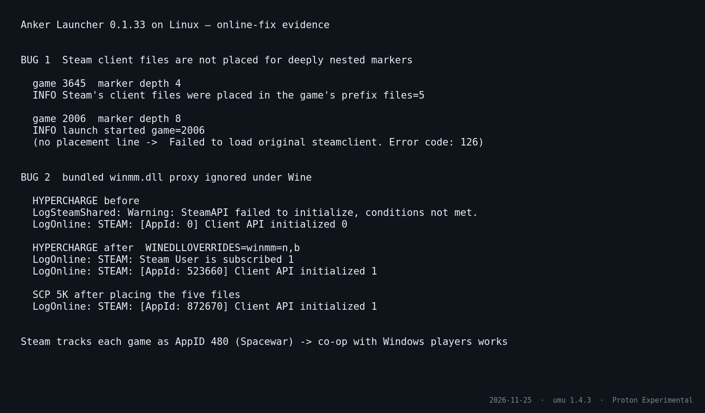

# How the AnkerGames fixes work

[← Games](../../README.md) · [Tarkov guide](games/tarkov.md) · **Deutsch:** [So funktioniert es](../de/wie-es-funktioniert.md)

**Reported against:** Anker Launcher 0.1.30/0.1.33, umu-launcher 1.4.3, Proton
Experimental (`11.0-100`), native Steam, CachyOS / KDE Wayland / NVIDIA.

## Anker Launcher 0.1.34

AnkerGames confirmed the causes of both Linux issues. The earlier general
scan stopped after three directory levels. In 0.1.34, the launcher also checks
`Engine/Binaries/ThirdParty/Steamworks` directly so it can find deeper markers
and provision the Steam client files in the prefix. For detected online-fix
builds, the launcher appends `winmm=n,b` to existing `WINEDLLOVERRIDES`.
AnkerGames says builds without an online fix use the same launch path as
before. [Official launcher download](https://ankergames.net/launcher).

The sections below document the original failures, the reference wrapper,
and the evidence collected on 0.1.30/0.1.33.

## 1 · How these builds work

Online-fix builds do **not** replace Steam. The fix DLL (`OnlineFix64.dll`, or a
`winmm.dll` / `steam_api64.dll` proxy) loads **Valve's real `steamclient64.dll`**
from inside the Wine prefix and connects it to the Steam client running on the
host:

```
<prefix>/drive_c/Program Files (x86)/Steam/
├── steamclient.dll            (from <Steam>/legacycompat/)
├── steamclient64.dll          (from <Steam>/legacycompat/)
├── GameOverlayRenderer64.dll  (from <Steam>/)
├── Steam.dll                  (from <Steam>/legacycompat/)
└── steam.exe                  (from <Steam>/legacycompat/SteamService.exe)
```

The path comes from the prefix registry:

```
[Software\\Valve\\Steam\\ActiveProcess]
"SteamClientDll64"="C:\\Program Files (x86)\\Steam\\steamclient64.dll"
"SteamPath"="C:\\Program Files (x86)\\Steam"
```

Missing files → `LoadLibrary` fails with **error 126** (`ERROR_MOD_NOT_FOUND`) —
exactly the error users see.

Proton performs this copy itself when it creates a prefix, but **only while
creating or upgrading one**. Anker creates prefixes through umu, so the
launcher's own copy step is the only reliable path afterwards.

---

## 2 · Defect A — the Steam client files are not placed

### Symptom

```
Failed to load original steamclient. Error code: 126
```

The game closes before the main menu.

### Cause

Before 0.1.34, the launcher detected online-fix builds by scanning the game
folder for marker files. The marker list extracted from the launcher binary:

```
steam_appid.txt  steam_settings  steam_emu.ini  ColdClientLoader.ini
cream_api.ini    OnlineFix.ini   realappid      SmartSteamEmu.ini
SteamConfig.ini  CPY.ini
```

`union-crax.ini` was absent from the extracted list. The deeper Steamworks
markers were outside the earlier general scan.

| Game | Marker | Depth | Launcher result |
|------|--------|-------|-----------------|
| HYPERCHARGE (3645) | `HYPERCHARGE Unboxed/Unboxed/Binaries/Win64/OnlineFix.ini` | 4 | ✅ files placed |
| Abyssus (2902) | `Abyssus/RGame/Binaries/Win64/OnlineFix.ini` | 4 | ✅ would be found |
| Species: Unknown (4035) | `Species Unknown/SpeciesUnknown/Binaries/Win64/OnlineFix.ini` | 4 | ✅ would be found |
| The Ascent (4013) | `The Ascent/Engine/Binaries/ThirdParty/Steamworks/Steamv152/Win64/steam_emu.ini` | 7 | ❌ missed |
| SCP 5K (2006) | `5K/WindowsNoEditor/Engine/Binaries/ThirdParty/Steamworks/Steamv151/Win64/OnlineFix.ini` | 8 | ❌ not found |

UE4/UE5 builds keep the Steamworks DLLs in
`Engine/Binaries/ThirdParty/Steamworks/<version>/Win64/`, so any UE build that
puts the fix there is 7–8 levels deep. The catalog already knows better: all of
these games are flagged `online_fix: true`.

### Original proposals for the launcher

* **Preferred:** use the catalog flag — if `online_fix` is true, place the five
  files. No filesystem guessing.
* **Minimum:** scan the whole game root (or at least depth 8) and add
  `union-crax.ini` to the marker list.
* **Always:** verify on **every** launch. The files are lost when the prefix is
  recreated, the game is reinstalled, or the user picks a new prefix.

---

## 3 · Defect B — the native `winmm.dll` proxy is ignored

### Symptom

The game starts, but Steam is not initialised:

```
LogSteamShared: Warning: SteamAPI failed to initialize, conditions not met.
LogOnline: Warning: STEAM: Steamworks: SteamUser() failed!
LogOnline: STEAM: [AppId: 0] Client API initialized 0
```

### Cause

The build ships a native `winmm.dll` next to the shipping executable
(`Unboxed/Binaries/Win64/winmm.dll`, `RGame/Binaries/Win64/winmm.dll`,
`TheAscent/Binaries/Win64/winmm.dll`). On Windows the application directory wins
the DLL search order, so the proxy loads. Under Wine the default for `winmm` is
`builtin, native`, so the proxy is skipped — the original `steam_api64.dll` runs
and `SteamAPI_Init` fails with AppId 0.

The inspected 0.1.30/0.1.33 launcher lacked the override on these launches.

### Reference wrapper approach

When a native `winmm.dll` exists under the game folder (depth ≤ 4 is enough in
practice), append the override:

```sh
export WINEDLLOVERRIDES="${WINEDLLOVERRIDES:+$WINEDLLOVERRIDES;}winmm=n,b"
```

Append, never overwrite — the variable is a semicolon-separated list and may
already contain the launcher's own overrides.

---

## 4 · The five games

Same launcher build, same runtime, same prefixes; the only change between runs is
the two fixes.

| ID | Game | Layout | Real AppID | Fake | Marker | Depth | Needs |
|----|------|--------|-----------|------|--------|-------|-------|
| 2006 | SCP 5K | A — `steam_api64.dll` | 872670 | 480 | `OnlineFix.ini` | 8 | A |
| 3645 | HYPERCHARGE: Unboxed | B — `winmm.dll` | 523660 | 480 | `OnlineFix.ini` | 4 | B |
| 2902 | Abyssus | B — `winmm.dll` | 1721110 | 480 | `OnlineFix.ini` | 4 | B |
| 4013 | The Ascent | C — `winmm.dll` + union-crax | 979690 | 480 | `steam_emu.ini` | 7 | A + B |
| 4035 | Species: Unknown | B — `winmm.dll` | 2747330 | 480 | `OnlineFix.ini` | 4 | B |

**Layout A** replaces `steam_api64.dll` and keeps the original as
`steam_api64.of`; the replacement resolves the real Steam client through the
registry, so only fix A is needed. SCP 5K is the only title in this set.

**Layout B** drops a native `winmm.dll` next to the executable. It pulls in
`OnlineFix64.dll`, which hooks `SteamAPI_Init` and connects to the real Steam
client — fix B is required.

**Layout C** is B plus `union-crax.ini` and `steam_emu.ini`. union-crax also
loads `steamclient64.dll`, so the marker is at depth 7 and both fixes are
needed.

### How "Steam initialised" was checked

* **UE4/UE5 games with a log** (SCP 5K, HYPERCHARGE): `LogSteamShared` /
  `LogOnline` lines. `Client API initialized 1` with the real AppID is the
  definitive proof.
* **Builds without a usable UE log** (Abyssus, The Ascent, Species: Unknown):
  the loaded modules (`OnlineFix64.dll`, `winmm.dll`, `steamclient64.dll`,
  `GameOverlayRenderer64.dll`) plus Steam's `gameprocess_log.txt`.
* **All five**: `~/.local/share/Steam/logs/gameprocess_log.txt` records
  `AppID 480 adding PID … as a tracked process`, which only happens after a
  successful Steam client handshake.

AppID 480 is Spacewar, Valve's public test app. The fix spoofs it so Steam allows
the client API to initialize. The process log records Steam tracking. A
Windows/Linux co-op join requires its own test.

### Historical reproduction on 0.1.30/0.1.33

1. Use a fresh test prefix for SCP 5K (2006).
2. Start it from the launcher → `Failed to load original steamclient. Error code: 126`.
3. Copy the five files into the prefix → the game starts and Steam initialises.
4. Start game 3645 (files present) → `[AppId: 0] Client API initialized 0`.
5. Start 3645 with `WINEDLLOVERRIDES=winmm=n,b` → `[AppId: 523660] Client API initialized 1`.

---

## 5 · Reference implementation

Both fixes in a wrapper in front of `umu-run` — the code used for the
verification above. Full commented file:
[`scripts/fix-reference.sh`](../../scripts/fix-reference.sh).

```sh
# 1) Steam client files for every online-fix build (any marker depth)
place_steam_client() {
  [ -n "$WINEPREFIX" ] || return 0
  steam_dir="$WINEPREFIX/drive_c/Program Files (x86)/Steam"
  [ -f "$steam_dir/steamclient64.dll" ] && return 0

  find "$(dirname "$1")" -maxdepth 8 \
       \( -iname 'OnlineFix.ini' -o -iname 'union-crax.ini' -o -iname 'steam_emu.ini' \) \
       -print -quit 2>/dev/null | grep -q . || return 0

  src="$HOME/.local/share/Steam"
  [ -f "$src/steamclient64.dll" ] || return 0

  mkdir -p "$steam_dir"
  cp -L "$src/steamclient64.dll"             "$steam_dir/steamclient64.dll"
  cp -L "$src/steamclient.dll"               "$steam_dir/steamclient.dll"
  cp -L "$src/GameOverlayRenderer64.dll"     "$steam_dir/GameOverlayRenderer64.dll"
  cp -L "$src/legacycompat/Steam.dll"        "$steam_dir/Steam.dll"
  cp -L "$src/legacycompat/SteamService.exe" "$steam_dir/steam.exe"
}

# 2) Prefer a bundled native winmm.dll (OnlineFix / union-crax / RUNE proxy)
case "$1" in
  *.exe)
    if find "$(dirname "$1")" -maxdepth 4 -iname 'winmm.dll' -print -quit 2>/dev/null | grep -q .; then
      export WINEDLLOVERRIDES="${WINEDLLOVERRIDES:+$WINEDLLOVERRIDES;}winmm=n,b"
    fi
    ;;
esac
```

Notes:

* Copy **after** the prefix exists, or create the directory tree yourself — Wine
  and Proton keep existing files.
* `steam.exe` is `SteamService.exe` renamed; that is what Proton does.
* Use `cp -L`: the Steam files can be symlinks in some installs (e.g. Flatpak).
* Refresh the five files when the Steam client updates; size/mtime is enough.
* The `find` calls are cheap for one launch, but a catalog flag avoids them.

---

## 6 · Evidence

Captured 2026-11-25 with Anker Launcher 0.1.33, umu-launcher 1.4.3 and Proton
Experimental. Paths are real; user names are omitted.



| File | Source | Shows |
|------|--------|-------|
| [`01-launcher-3645-placed.txt`](../../evidence/01-launcher-3645-placed.txt) | launcher log | HYPERCHARGE (depth 4) → `Steam's client files were placed … files=5` |
| [`02-launcher-2006-missing.txt`](../../evidence/02-launcher-2006-missing.txt) | launcher log | SCP 5K (depth 8) → no placement line, then error 126 |
| [`03-hypercharge-before.txt`](../../evidence/03-hypercharge-before.txt) | `Unboxed.log` | `SteamAPI failed to initialize` · `[AppId: 0]` |
| [`04-hypercharge-after.txt`](../../evidence/04-hypercharge-after.txt) | `Unboxed.log` | `Steam SDK Loaded!` · `[AppId: 523660] Client API initialized 1` |
| [`05-scp5k-steam-init.txt`](../../evidence/05-scp5k-steam-init.txt) | `Pandemic.log` | `[AppId: 872670] Client API initialized 1` after the files were placed |
| [`06-steam-tracks-480.txt`](../../evidence/06-steam-tracks-480.txt) | `gameprocess_log.txt` | Steam tracks the externally started games as AppID 480 |
| [`07-prefix-layout.txt`](../../evidence/07-prefix-layout.txt) | `ls -l` | the five expected files in the prefix |
| [`08-spp-tarkov-server.txt`](../../evidence/08-spp-tarkov-server.txt) | app host output, server log | missing ASP.NET runtime, CNG certificate failure, native server answering |
| [`09-spp-tarkov-linux-launcher.txt`](../../evidence/09-spp-tarkov-linux-launcher.txt) | wrapper and launcher log | native launcher instead of WebView2, game process, backend requests |
| [`10-fika-coop.txt`](../../evidence/10-fika-coop.txt) | server and client log | Fika loaded, `0.0.0.0:6969`, login over the LAN IP |

Key excerpts:

```
16:24:59  INFO Steam's client files were placed in the game's prefix files=5   ← 3645
16:28:53  INFO launch started game=2006                                        ← no placement line
          Failed to load original steamclient. Error code: 126

- LogSteamShared: Warning: SteamAPI failed to initialize, conditions not met.
- LogOnline: STEAM: [AppId: 0] Client API initialized 0
+ LogSteamShared: Steam SDK Loaded!
+ LogOnline: STEAM: [AppId: 523660] Client API initialized 1

[2026-11-25 18:01:17] AppID 480 adding PID 231790 as a tracked process
```

The prefix layout (`07`):

```
-rwxr-xr-x  1692312  GameOverlayRenderer64.dll
-rwxr-xr-x 26787480  steamclient64.dll
-rwxr-xr-x 21837464  steamclient.dll
-rwxr-xr-x   385312  Steam.dll
-rwxr-xr-x  2812312  steam.exe
```

---

## 7 · Known limitation — overlay and invites

Steam only injects its overlay (Shift+Tab, invite dialog) into games it launches
itself. A game started by the launcher is tracked as AppID 480 but gets no
`gameoverlayui` process, so Shift+Tab does nothing. The game's Steam API works
(friends list, lobbies, server lists) and friends can join through the game's own
UI, but overlay-based invites do not work.

If overlay invites matter, the clean solution is an opt-in **"Add to Steam"**
action: create a non-Steam shortcut and let Steam start the game (the launcher
already has `steam_shortcut_add`). That path needs the same five files in Steam's
own compatdata prefix.

---

## 8 · Metadata note — the "Co-Op" badge

`co_op: true` is currently a genre tag. For builds that are offline-only — for
example Call of Duty: Modern Warfare II (2522), a Goldberg build with only the
`sp22` campaign client and no `mp22` folder — it reads like "co-op works here".

Suggestion: gate the badge on `online_fix` / `multiplayer`, or add an explicit
"offline only" hint. Catalog metadata is otherwise correct for those titles.

---

## 9 · SPP Tarkov is a different failure

Escape from Tarkov (3089) is **not** a Steam title. The package is SPP Tarkov, a
single-player project with its own local server; no Steam client API is involved,
so neither fix applies. Its blockers are .NET runtimes, the Play target and the
WebView2 launcher — see the [Tarkov guide](games/tarkov.md). Co-op is included as Fika:
[Tarkov co-op](games/tarkov.md#3--co-op).
