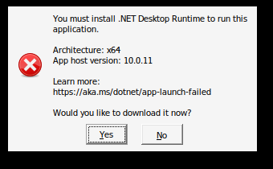
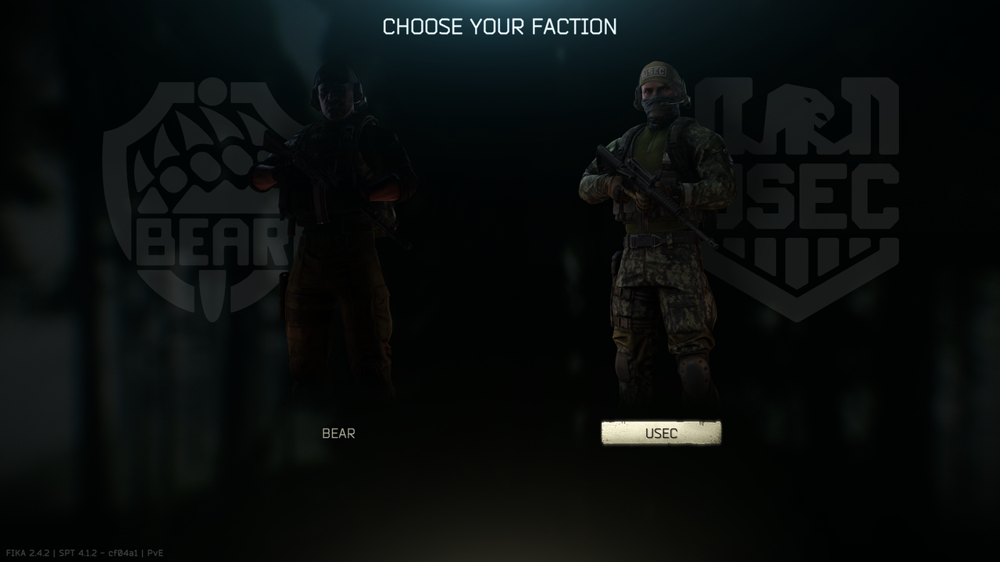

# SPP Tarkov on Linux: from Play to the game

[← Overview](../../README.md) · [Co-op](coop.md) · [Background](background.md) · **Deutsch:** [Tarkov](../de/tarkov.md)

**Game:** Escape from Tarkov (3089) — the SPP Tarkov single-player package
**Tested with:** Anker Launcher 0.1.30/0.1.33, umu-launcher 1.4.3, Proton
Experimental (`11.0-100`), CachyOS / KDE Wayland

This has nothing to do with Steam. The package needs .NET runtimes inside its
Wine prefix, and its Windows launcher does not render under Wine. Four steps fix
both — the [README](../../README.md) has them as a copy-paste block, this page
explains them.

---

## What is broken

| # | Problem | What you see |
|---|---|---|
| 1 | The installer is a .NET 10 WPF app, the prefix has no runtime | *"You must install .NET Desktop Runtime"* |
| 2 | The SPT server needs ASP.NET Core | `Framework: 'Microsoft.AspNetCore.App', version '10.0.0'` |
| 3 | Play starts the **installer**, not the game | the wizard re-extracts 64.7 GB on every Play |
| 4 | The Windows launcher is WebView2 under Wine | white window, cursor disappears |

Steps 1–2 fix the runtime, step 3 the Play target, step 4 the launcher window.

---

## Before you start

* AnkerGames with SPP Tarkov (3089) installed.
* This repository, and a shell in its folder.
* Two paths — find them in AnkerGames → the game → launch settings:

| Placeholder | Example |
|---|---|
| `<prefix>` | `/mnt/daten/Games/AnkerGames/Games/Prefixes/3089` |
| `<game dir>` | `/mnt/daten/Games/AnkerGames/Games/Escape from Tarkov-3089` |

---

## Step 1 · .NET 10 into the prefix

`SPP_Tarkov_Installer.exe` is framework-dependent (`net10.0-windows`) and asks
for `Microsoft.WindowsDesktop.App` 10.0.x. Wine ships no .NET at all, so the app
host stops before a window appears:



```sh
scripts/install-dotnet-runtime.sh "<prefix>"
```

The script downloads the official win-x64 runtime zips and extracts them to
`<prefix>/drive_c/Program Files/dotnet` — the default probe path of the .NET app
host, so no environment variable or registry change is needed. It is idempotent.

Do **not** run the `.exe` installers under Wine: the bundle is a WiX/Burn
executable and fails in most prefixes. The zips are the reliable path.

---

## Step 2 · ASP.NET Core for the server

`SPT.Server.exe` additionally needs `Microsoft.AspNetCore.App`:

```sh
scripts/install-dotnet-runtime.sh "<prefix>" --aspnet
```

Only adds the third runtime; safe to run again.

---

## Step 3 · Play must start the game, not the installer

`Play` starts `SPP_Tarkov_Installer.exe` because that is all the package
contains — the archive holds the installer plus `Data.bin`, and nothing tells the
launcher what to start afterwards.

> **Fresh install?** Press Play once now, run the wizard (it unpacks ~64.7 GB
> into the game folder), then continue here.

```sh
scripts/spp-tarkov-play-target.sh "<game dir>" "<prefix>"
```

The script copies the 246 KB `Launcher.exe` stub into the game folder, links
`SPT_Runtime`, and records `Launcher.exe` as the game's executable in
`~/.config/net.ankergames.launcher/library.json` (backup included).

**Close AnkerGames first** — it rewrites that file on start.

Manual alternative: AnkerGames → the game → launch settings → choose
`Launcher.exe`.

---

## Step 4 · The native launcher instead of WebView2

The Windows launcher is Photino/Blazor on WebView2. Under Wine its page is a D3D
swapchain in a child window owned by `msedgewebview2.exe`, and that surface does
not present — the window stays white. WebView2 also sets the cursor from the
browser process, and Wine cannot turn that handle into an X11 cursor
([Wine bug 58922](https://bugs.winehq.org/show_bug.cgi?id=58922)).

`WEBVIEW2_ADDITIONAL_BROWSER_ARGUMENTS=--disable-gpu` is the usual advice and
cannot work here: Photino passes its own `AdditionalBrowserArguments`, so
WebView2 ignores the environment variable and the registry policy.

The package ships the same launcher built natively for Linux. It renders with
GTK/WebKit — no Wine, no WebView2 — and starts the game through umu/Proton
itself:

```sh
scripts/spp-tarkov-linux-launcher.sh "<prefix>"
```

The script does two things:

1. Writes `SPT_Runtime/user/Launcher/LauncherSettings.json` (backup included):

   | key | value |
   |---|---|
   | `GamePath` | `<prefix>/drive_c/Games/SPP-Tarkov` |
   | `LinuxSettings.PrefixPath` | `<prefix>` |
   | `LinuxSettings.UmuPath` | `/usr/bin/umu-run` — the Python script, not a shell wrapper |
   | `LinuxSettings.ProtonVersion` | the Proton folder, e.g. `…/common/Proton - Experimental` |

2. Inserts a marked block into `~/.local/bin/umu-run`. For a `Launcher.exe` with
   `SPT_Runtime/SPT.Launcher.Linux` next to it, the block starts the native
   launcher — and the native server first, if it is not answering yet.

The block keys on the file, not on `GAMEID`: AnkerGames uses `3089` for some
installs and `umu-<number>` for others.

---

## Step 5 · Check it works

Press **Play**. Expected:

1. A window titled **SPT Launcher** (the native one; the Windows launcher is
   titled *SPP Tarkov - Servers*).
2. `Local Server` turns **ONLINE** after ~40 s.
3. **START GAME** → `EscapeFromTarkov.exe` under Proton → character screen.




The launcher window is the native build, so the cursor is the normal desktop
cursor.

---

## Everyday use

* Just press **Play**. The wrapper starts the native server, then the launcher.
* Server manually:

  ```sh
  scripts/spp-tarkov-server.sh "<game dir>"            # start
  scripts/spp-tarkov-server.sh "<game dir>" --status   # is it up?
  scripts/spp-tarkov-server.sh "<game dir>" --stop     # stop
  ```

* `SPP_WINE_LAUNCHER=1` starts the **Windows** launcher under Wine instead. It
  needs Windows-style paths in `LauncherSettings.json`, and the white
  window/cursor problem remains — only useful for comparison.
* A new or recreated prefix needs steps 1, 2 and 4 again.

---

## Troubleshooting

| Symptom | Cause | Fix |
|---|---|---|
| Window stays white, title *SPP Tarkov - Servers* | the Windows launcher is running | re-run step 4; make sure `SPP_WINE_LAUNCHER` is not set |
| Window white **and** no cursor | Windows launcher + [Wine bug 58922](https://bugs.winehq.org/show_bug.cgi?id=58922) | same — use the native launcher |
| Still *"You must install .NET Desktop Runtime"* | runtime in the wrong prefix, or version < 10.0 | check `<prefix>/drive_c/Program Files/dotnet/shared/Microsoft.WindowsDesktop.App` |
| `Framework: 'Microsoft.AspNetCore.App', version '10.0.0'` | ASP.NET Core runtime missing | `scripts/install-dotnet-runtime.sh "<prefix>" --aspnet` |
| `CryptographicException: Erfolg.` at `CopyWithPrivateKey` | CNG is not implemented in Proton's Wine | run the native server (step 4 / `spp-tarkov-server.sh`) |
| `System.ConsolePal.set_Title` / "Ungültiger Zugriff" | `SPT.Server.exe` started from a Unix terminal, no Windows console | start it with `wine start`, or use the native server |
| `Local Server` stays OFFLINE without an error | server not running, or still booting (~40 s) | `scripts/spp-tarkov-server.sh "<game dir>" --status` |
| `Could not find file '...database\itemsToAdd.json'` | a mod builds a path with a backslash | link the file under the literal name: `ln -s database/itemsToAdd.json 'database\itemsToAdd.json'` |
| `Nicht behebbarer Systemfehler` / `MS.Internal.Invariant.FailFast` right after the window appears | no usable font family in the prefix | `WINEPREFIX="<prefix>" winetricks -q corefonts` |
| `Failed to create CoreCLR` or an immediate crash | W^X under Wine | launch with `DOTNET_EnableWriteXorExecute=0` |
| Installer starts, but Play keeps offering the installer | game installed outside the managed folder, or step 3 not applied | reinstall into the managed folder; re-run step 3 |
| Launcher opens, **START GAME** does nothing | server offline, or game path wrong | check the server status; check `GamePath` in `LauncherSettings.json` |

Logs:

```
~/.local/share/net.ankergames.launcher/logs/games/prefix-3089.log   wrapper output
~/.local/share/spt-server.log                                      native server
<game dir>/Logs/                                                   game client
```

---

## Why it fails

`SPP_Tarkov_Installer.exe` is a framework-dependent WPF app; a framework-dependent
.NET app does not carry the runtime and asks the host for
`Microsoft.WindowsDesktop.App`. Wine and Proton ship their own `mscoree` stub and
no .NET runtime, so the app host stops before any window is drawn.

The server adds two problems: it needs `Microsoft.AspNetCore.App`, and under Wine
it cannot create its self-signed TLS certificate — `CopyWithPrivateKey` goes
through CNG, which Proton's Wine does not implement. Hand-made PEM files do not
help either, because loading them uses the same path. The native
`SPT.Server.Linux` from the package avoids both.

The launcher's white window is the WebView2 compositing problem described in
step 4. Evidence: [`09-spp-tarkov-linux-launcher.txt`](../../evidence/09-spp-tarkov-linux-launcher.txt)
and [`08-spp-tarkov-server.txt`](../../evidence/08-spp-tarkov-server.txt).

---

## Suggestion for the launcher

* **Declare the runtime.** Add .NET Desktop Runtime 10 (plus ASP.NET Core for
  SPT) to the catalog entry for 3089 and provision it the same way the launcher
  does for other titles — extracting the official zips works without running any
  Windows installer.
* **Or ship it self-contained.** A self-contained installer grows by ~70 MB and
  removes the dependency entirely.
* **Pick the right target after install.** After the wizard, `Launcher.exe`
  exists in the game folder; Play should use it instead of the installer.

A prefix is recreated on reinstall or when the user picks a new prefix, so the
runtime has to be provisioned again in that case. Provisioning at launch is the
robust variant.
